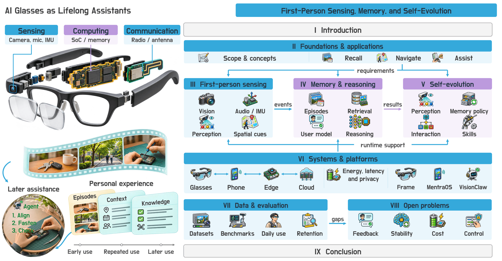
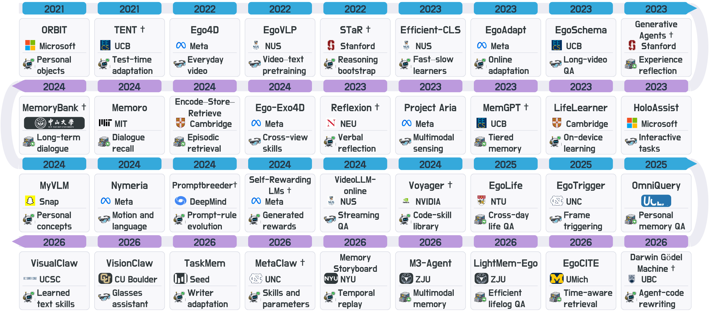
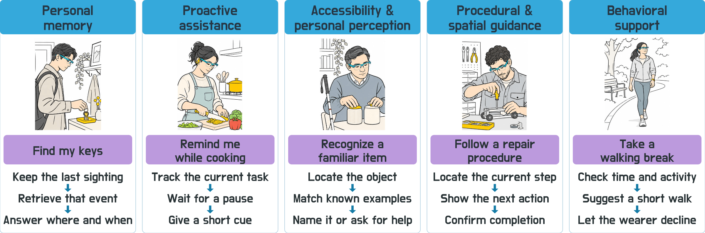
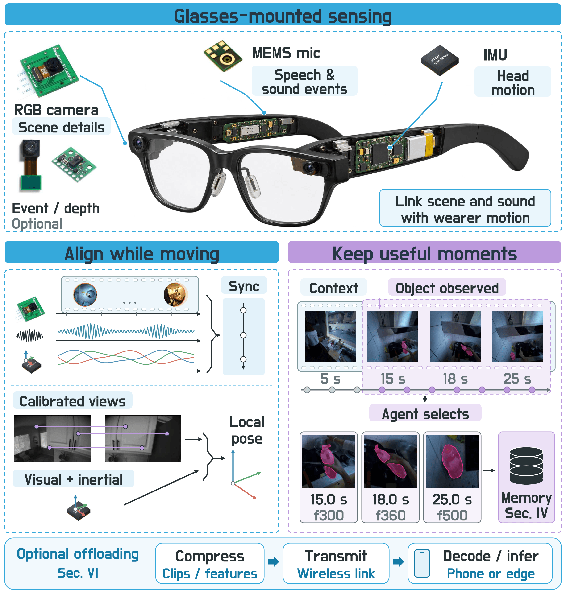
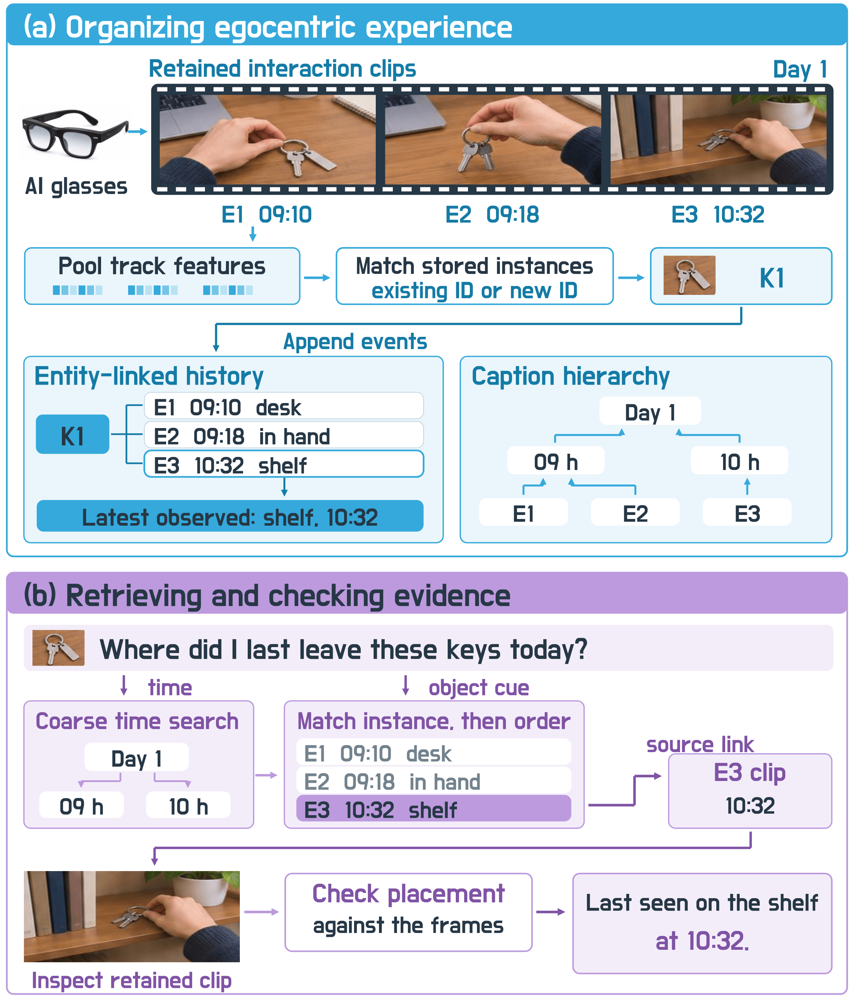
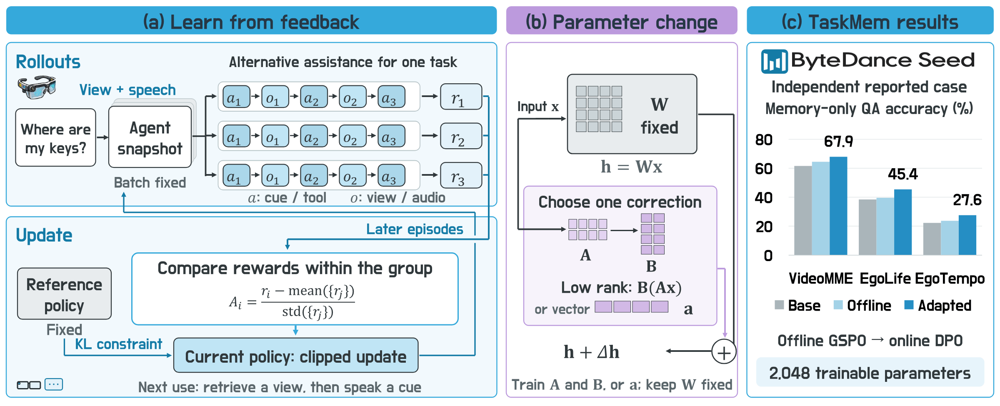
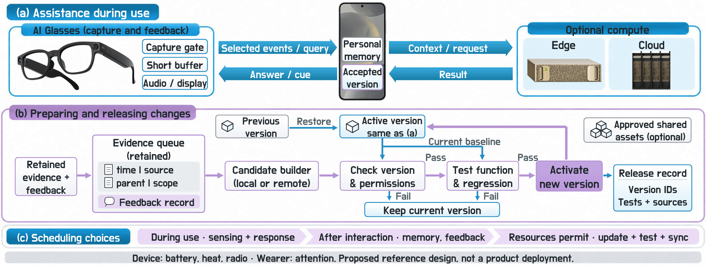
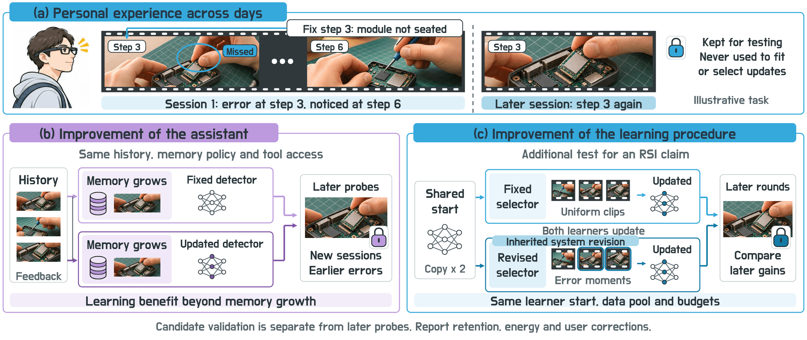

<div id="top" align="center">

# AI Glasses as Lifelong Assistants

### First-Person Sensing, Memory, and Self-Evolution

[](https://doi.org/10.13140/RG.2.2.33537.21606)
[](https://doi.org/10.13140/RG.2.2.33537.21606)
[](https://awesome.re)
[](#contents)
[](#contributing)
[](LICENSE)
[](https://github.com/fangzr/Awesome-AI-Glasses/stargazers)

**Zhengru Fang**<sup>1</sup>, **Senkang Hu**<sup>2</sup>, **Yaoyu Zhu**<sup>1,3</sup>, **Zehao Liu**<sup>1,4</sup>, **Chenxi Li**<sup>1</sup>, **Xizhi Wang**<sup>1</sup>, **Ming Yu Tsoi**<sup>1</sup>,<br>
**Yufan Zhuang**<sup>1</sup>, **Junlong Li**<sup>5</sup>, **Yu Guo**<sup>2</sup>, **Enqi Zhao**<sup>1</sup>, **Xuanrui Zhu**<sup>1</sup>, **Yuguang Fang**<sup>2</sup>, **Jun Zhang**<sup>1,✉</sup>

<sup>1</sup>The Hong Kong University of Science and Technology &nbsp; <sup>2</sup>City University of Hong Kong &nbsp; <sup>3</sup>Southeast University<br>
<sup>4</sup>Tsinghua University &nbsp; <sup>5</sup>The Hong Kong Polytechnic University &nbsp; <sup>✉</sup>Corresponding author

</div>

<p align="center"></p>

<p align="center"><sub><b>Fig. 1.</b> AI glasses as lifelong assistants and the organization of this survey. First-person observations accumulate into personal experience for later assistance; arrows mark relationships rather than a mandatory sequence.</sub></p>

> If the glasses remember where you last put your keys, can they also learn when to remind you before you leave?

This repository accompanies our survey **["AI Glasses as Lifelong Assistants: First-Person Sensing, Memory, and Self-Evolution"](https://doi.org/10.13140/RG.2.2.33537.21606)** (preprint on ResearchGate, DOI: [10.13140/RG.2.2.33537.21606](https://doi.org/10.13140/RG.2.2.33537.21606)). It collects the **336 works** the survey discusses (76 with linked code), organized chapter by chapter, together with the survey's figures and its comparison tables of surveys, products, memory systems, open platforms, datasets, and benchmarks.

## <a id="news"></a>🔥 News

- **[2026-11-26]** Repository released with the full reference list, all eight figures, and the survey's comparison tables.
- **[2026-11]** The survey preprint is available on [ResearchGate](https://doi.org/10.13140/RG.2.2.33537.21606) (DOI: 10.13140/RG.2.2.33537.21606).

## <a id="overview"></a>📌 Overview

Multimodal large language models are turning AI glasses into an interface for personal agents that help throughout the day. Hands-free first-person sensing answers immediate questions, and personal memory connects current needs with earlier experience. **Lifelong assistance** adds continuity and adaptation across repeated use by the same wearer: deciding when to intervene, keeping the wearer in control of retained experience, and learning from feedback without losing useful capabilities.

The survey examines three interconnected foundations and the conditions that make them work in practice:

| | Question | Chapter |
| :-- | :-- | :--: |
| 👁️ **First-person sensing** | What can glasses-mounted sensors observe, align, and keep? | [III](#sensing) |
| 🧠 **Personal memory** | How does experience become recall, reasoning, and tool use under fixed rules? | [IV](#memory) |
| 🔁 **Self-evolution** | How do feedback and experience *persistently* change perception, memory policies, interaction, skills, and models? | [V](#evolution) |
| 📡 **Systems** | How do communication, storage, and computation across glasses, phone, edge, and cloud compete with responsive assistance? | [VI](#systems) |
| 📊 **Evaluation** | Which datasets and study designs can separate a persistent update from an improvement in later use? | [VII](#evaluation) |

**What sets this survey apart.** Earlier surveys cover egocentric perception, smart-glasses hardware and interaction, personal agents, or self-evolving agents in general. We focus on **learning through repeated wearable use**: we distinguish memory growth, personalization, continual adaptation, and self-evolution; compare update mechanisms by supervision, persistence, and operating cost; and state what evidence would show that a wearer actually benefits later.

### 💡 Key Takeaways

1. **Diagnose before learning.** Missing observations and stale facts may need better capture or ordinary memory maintenance; recurring selection and decision errors may justify persistent updates.
2. **An update must fit the glasses setting.** Cheap feedback can be ambiguous, and a small adapter can still depend on costly teachers, communication, and validation.
3. **Evidence must match the claim.** Component replay isolates a mechanism on common data; live assistance needs comparable starting conditions and budgets while behavior and later observations change.
4. **Repeated-day evidence on glasses is still missing.** Of 46 selected methods relevant to first-person or body-worn settings, eight meet all three criteria (a persistent change, driven by experience, with a comparative benefit) at their reported component boundary. Seven of them evaluate on recorded streams or benchmarks; sustained benefit from coupled updates during everyday AI-glasses use remains unverified.

## <a id="structure"></a>🗺️ Survey Structure

| Chapter | Title | Focus |
| :--: | :-- | :-- |
| I | Introduction | Lifelong assistance, positioning, contributions |
| II | [AI Glasses: Foundations, Applications, and Requirements](#foundations) | Platforms, key concepts, applications and derived requirements |
| III | [First-Person Sensing and Perception](#sensing) | Observation, alignment and fusion, egocentric understanding, selective acquisition |
| IV | [Personal Memory and Memory-Grounded Reasoning](#memory) | Representation, retrieval and maintenance, reasoning and tool use |
| V | [Methods for Self-Evolving Wearable Agents](#evolution) | Learning signals; perception, memory-policy, interaction, skill, and model updates; validation |
| VI | [Computing, Communication, and Open Platforms](#systems) | Partitioning, communication, scheduling, privacy and controlled release, open platforms |
| VII | [Datasets, Benchmarks, and Longitudinal Evaluation](#evaluation) | Data, benchmarks, evidence criteria, metrics, repeated-use study design |
| VIII | [Open Challenges and Future Directions](#open) | Feedback, observation and retention, cost and consistency, user control |
| IX | Conclusion | |

Each paper below appears once, under the subsection where the survey discusses it most. Tables are sorted newest first. Star badges link to official code when it is listed on the paper's Hugging Face page.

## <a id="contents"></a>📑 Contents

<details open><summary>Expand / collapse</summary>

- [📖 Related Surveys](#surveys)
  - [Survey Papers](#surveys-list) (12)
- [🕶️ II. AI Glasses: Foundations, Applications, and Requirements](#foundations)
  - [Background and Motivation](#intro) (2)
  - [II-A. AI Glasses and Related First-Person Platforms](#platforms) (8)
  - [II-B. Key Concepts: Adaptation, Personalization, and Self-Improvement](#concepts) (16)
  - [II-C. Applications and Derived Requirements](#applications)
    - [II-C1. Personal Memory and Everyday Assistance](#app-memory)
    - [II-C2. Proactive Assistance and Interaction Timing](#app-proactive) (2)
    - [II-C3. Accessibility and Personal Perception](#app-access) (1)
    - [II-C4. Procedural and Spatial Guidance](#app-guidance) (2)
    - [II-C5. Behavioral Support and Longitudinal Interaction](#app-behavior) (1)
- [👁️ III. First-Person Sensing and Perception](#sensing)
  - [Representative Commercial AI Glasses (Table II)](#products)
  - [III-A. What First-Person Streams Record and Miss](#sense-observe) (5)
  - [III-B. Alignment and Fusion under Wearer Motion](#sense-fusion) (3)
  - [III-C. Egocentric Understanding for Assistance](#sense-understand) (7)
  - [III-D. Selective Acquisition and Curation](#sense-curation) (3)
- [🧠 IV. Personal Memory and Memory-Grounded Reasoning](#memory)
  - [Representative Personal Memory Systems (Table III)](#memory-systems)
  - [IV-A. Representing Personal Experience](#mem-represent) (19)
  - [IV-B. Retrieving and Maintaining Long-Term Memory](#mem-maintain) (12)
  - [IV-C. Memory-Grounded Reasoning, Planning, and Tool Use](#mem-reason) (9)
- [🔁 V. Methods for Self-Evolving Wearable Agents](#evolution)
  - [Feedback Families for Wearable Learning (Table IV)](#signals)
  - [Choosing an Update: Supervision, Persistence, and Operating Trade-offs (Table V)](#mechanisms)
  - [V-A. Learning Signals and Feedback](#m-signal) (15)
  - [V-B. Perception Adaptation](#m-perception) (25)
  - [V-C. Learning Memory Policies and User Models](#m-memory) (4)
  - [V-D. Adapting Reasoning and Interaction Policies](#m-policy) (15)
  - [V-E. Skill Acquisition and Tool-Use Refinement](#m-skills) (15)
  - [V-F. Model and World-Model Updates](#m-model) (26)
  - [V-G. Validating and Retaining Updates](#m-validate) (15)
- [📡 VI. Computing, Communication, and Open Platforms](#systems)
  - [Public AI-Glasses Platforms (Table VI)](#open-platforms)
  - [VI-A. Partitioning Across Glasses, Phone, Edge, and Cloud](#architecture) (8)
  - [VI-B. Communication for Serving and Learning](#comm) (10)
  - [VI-C. Scheduling and Resource Budgets](#scheduling) (21)
  - [VI-D. Privacy, Security, and Controlled Updates](#privacy) (10)
  - [VI-E. Open Platforms in Practice](#platform-papers) (2)
  - [Platform Documentation](#platform-docs) (2)
- [📊 VII. Datasets, Benchmarks, and Longitudinal Evaluation](#evaluation)
  - [First-Person Datasets (Table VII)](#datasets)
  - [Benchmarks (Table VIII)](#benchmarks)
  - [VII-A. Dataset Papers](#e-data) (8)
  - [VII-B. Benchmark Papers](#e-bench) (22)
  - [VII-C–F. Evidence Criteria, Metrics, and Study Design](#e-eval) (10)
- [🚀 VIII. Open Challenges and Future Directions](#open)
  - [Open Problems and Tests That Would Advance the Evidence (Table X)](#roadmap)
  - [Related Work Cited in Open Challenges](#open-papers) (3)
- [🧩 Products, Hardware, and Developer Resources](#resources)
  - [Documentation and Specifications](#resource-list) (23)

</details>

## <a id="surveys"></a>📖 Related Surveys

How this survey relates to neighboring surveys on egocentric vision, AI glasses, personal agents, continual learning, and self-evolving agents (Table I of the paper). ● covered, ◐ partly covered, ○ not a focus.

### Coverage of Related Surveys

| Survey | First-person sensing | External memory | Persistent updates | Resource costs | Evaluation protocols | Organizing perspective | Link |
| :-- | :--: | :--: | :--: | :--: | :--: | :-- | :--: |
| Plizzari et al. (PoliTo) | ● | ◐ | ◐ | ◐ | ● | Egocentric tasks and future assistants | [paper](https://doi.org/10.1007/s11263-024-02095-7) |
| Yuan et al. (PolyU) | ● | ● | ◐ | ● | ◐ | Glasses hardware, intelligence and interaction | [paper](https://arxiv.org/abs/2609.19793) |
| Zhang et al. (ZJU) | ● | ● | ◐ | ● | ● | First-person capabilities and system evidence | [paper](https://arxiv.org/abs/2608.24877) |
| Li et al. (THU) | ◐ | ● | ● | ● | ● | Personal agents: capability, efficiency, security | [paper](https://arxiv.org/abs/2401.05459) |
| Wang et al. (THU) | ○ | ○ | ● | ● | ● | Continual learning, retention and transfer | [paper](https://doi.org/10.1109/tpami.2024.3367329) |
| Gao et al. (THU) | ○ | ● | ● | ● | ● | Agent evolution: targets, signals and timing | [paper](https://arxiv.org/abs/2507.21046) |
| Fang et al. (Glasgow) | ○ | ● | ● | ◐ | ● | Optimization of single- and multi-agent systems | [paper](https://arxiv.org/abs/2508.07407) |
| Feng et al. (THU) | ○ | ● | ● | ◐ | ◐ | Self-evolution in embodied systems | [paper](https://arxiv.org/abs/2602.04411) |
| Chen et al. (DeepGrounding) | ○ | ◐ | ● | ◐ | ● | Recursive improvement and verification limits | [paper](https://arxiv.org/abs/2607.07663) |
| This survey (HKUST) | ● | ● | ● | ● | ● | Learning through repeated wearable use |  |

### <a id="surveys-list"></a>Survey Papers

<sub>**Also discussed here:** [Li et al.](https://arxiv.org/abs/2511.13261)</sub>

| Paper | Venue | Links |
| :-- | :--: | :-- |
| **[A Survey of Self-Evolving Agents: What, When, How, and Where to Evolve on the Path to Artificial Super Intelligence](https://arxiv.org/abs/2507.21046)**<br><sub>Gao et al.</sub> | TMLR 2026 | [](https://arxiv.org/abs/2507.21046) [](https://github.com/CharlesQ9/Self-Evolving-Agents) |
| **[AI Smart Glasses for Wearable Intelligence: From Egocentric Sensing to Agentic Personalization](https://arxiv.org/abs/2609.19793)**<br><sub>Yuan et al.</sub> | arXiv 2026 | [](https://arxiv.org/abs/2609.19793) |
| **[From Seeing to Acting: Smart Glasses as First-Person Intelligence Platforms](https://arxiv.org/abs/2608.24877)**<br><sub>Zhang et al.</sub> | arXiv 2026 | [](https://arxiv.org/abs/2608.24877) [](https://github.com/zhangzjn/awesome-smart-glasses) |
| **[Recursive Self-Improvement in AI: From Bounded Self-Refinement to Autonomous Research Loops](https://arxiv.org/abs/2607.07663)**<br><sub>Chen et al.</sub> | arXiv 2026 | [](https://arxiv.org/abs/2607.07663) |
| **[Self-evolving Embodied AI](https://arxiv.org/abs/2602.04411)**<br><sub>Feng et al.</sub> | arXiv 2026 | [](https://arxiv.org/abs/2602.04411) [Paper](https://doi.org/10.1093/nsr/nwag662) |
| **[Self-Improvements in Modern Agentic Systems: A Survey](https://arxiv.org/abs/2607.13104)**<br><sub>Ren et al.</sub> | arXiv 2026 | [](https://arxiv.org/abs/2607.13104) [](https://github.com/selfimproving-agent/awesome-Self-Improving-Agents) [Project](https://selfimproving-agent.github.io/) |
| **[Watch, Remember, Reason: Human-View Video Understanding with MLLMs](https://arxiv.org/abs/2606.07433)**<br><sub>Meng et al.</sub> | arXiv 2026 | [](https://arxiv.org/abs/2606.07433) [](https://github.com/marinero4972/Awesome-HumanView-VideoUnderstanding) |
| **[A Comprehensive Survey of Self-Evolving AI Agents: A New Paradigm Bridging Foundation Models and Lifelong Agentic Systems](https://arxiv.org/abs/2508.07407)**<br><sub>Fang et al.</sub> | arXiv 2025 | [](https://arxiv.org/abs/2508.07407) [](https://github.com/EvoAgentX/Awesome-Self-Evolving-Agents) [Project](https://huggingface.co/spaces/X-iZhang/Awesome-Self-Evolving-Agents) |
| **[Lifelong Learning of Large Language Model based Agents: A Roadmap](https://arxiv.org/abs/2501.07278)**<br><sub>Zheng et al.</sub> | arXiv 2025 | [](https://arxiv.org/abs/2501.07278) [](https://github.com/qianlima-lab/awesome-lifelong-llm-agent) [Paper](https://doi.org/10.1109/tpami.2025.3650546) |
| **[A Comprehensive Survey of Continual Learning: Theory, Method and Application](https://doi.org/10.1109/tpami.2024.3367329)**<br><sub>Wang et al.</sub> | TPAMI 2024 | [](https://arxiv.org/abs/2302.00487) [](https://github.com/lywang3081/Awesome-Continual-Learning) [Paper](https://doi.org/10.1109/tpami.2024.3367329) |
| **[An Outlook into the Future of Egocentric Vision](https://doi.org/10.1007/s11263-024-02095-7)**<br><sub>Plizzari et al.</sub> | IJCV 2024 | [](https://arxiv.org/abs/2308.07123) [Paper](https://doi.org/10.1007/s11263-024-02095-7) |
| **[Personal LLM Agents: Insights and Survey about the Capability, Efficiency and Security](https://arxiv.org/abs/2401.05459)**<br><sub>Li et al.</sub> | arXiv 2024 | [](https://arxiv.org/abs/2401.05459) |

<p align="right"><a href="#top">⬆ back to top</a></p>

## <a id="foundations"></a>🕶️ II. AI Glasses: Foundations, Applications, and Requirements

<p align="center"></p>

<p align="center"><sub><b>Fig. 2.</b> Selected advances toward lifelong AI assistance: first-person sensing and QA, life and long-term memory, and adaptation, personalization, and self-evolution († general-agent methods). Logos identify first-author affiliations.</sub></p>

### <a id="intro"></a>Background and Motivation

<sub>**Also discussed here:** [EgoLife](https://doi.org/10.1109/cvpr52734.2025.02690) · [Zhang et al.](https://doi.org/10.18653/v1/2025.emnlp-main.605) · [Satori](https://doi.org/10.1145/3706598.3714188) · [Project Aria](https://arxiv.org/abs/2308.13561) · [VideoLLM-online](https://doi.org/10.1109/cvpr52733.2024.01742) · [MM-Ego](https://arxiv.org/abs/2410.07177) · [VisionClaw](https://arxiv.org/abs/2604.03486) · [HoloAssist](https://doi.org/10.1109/iccv51070.2023.01854) · [OmniQuery](https://doi.org/10.1145/3706598.3713448) · [Memoro](https://doi.org/10.1145/3613904.3642450) · [Egocentric Co-Pilot](https://doi.org/10.1145/3774904.3792996) · [SenseCam](https://doi.org/10.1007/11853565_11) · [MyLifeBits](https://doi.org/10.1145/1107458.1107460) · [LifeLogging](https://doi.org/10.1561/9781601988034) · [Ego4D](https://arxiv.org/abs/2110.07058) · [Ego-Exo4D](https://doi.org/10.1109/cvpr52733.2024.01834) · [A Continual Learning Survey](https://doi.org/10.1109/tpami.2021.3057446) · [Wang et al.](https://doi.org/10.1109/tpami.2024.3367329) · [Reflexion](https://doi.org/10.52202/075280-0377) · [Voyager](https://arxiv.org/abs/2305.16291) · [Edge Intelligence](https://doi.org/10.1109/jproc.2019.2918951) · [Ekya](https://arxiv.org/abs/2012.10557) · [LifeLearner](https://doi.org/10.1145/3625687.3625804)</sub>

| Paper | Venue | Links |
| :-- | :--: | :-- |
| **[Building Egocentric Procedural AI Assistant: Methods, Benchmarks, and Challenges](https://arxiv.org/abs/2511.13261)**<br><sub>Li et al.</sub> | arXiv 2025 | [](https://arxiv.org/abs/2511.13261) |
| **[The Wearable Remembrance Agent: A System for Augmented Memory](https://doi.org/10.1007/bf01682024)**<br><sub>Rhodes</sub> | Pers. Technol. 1997 | [Paper](https://doi.org/10.1007/bf01682024) |

### <a id="platforms"></a>II-A. AI Glasses and Related First-Person Platforms

<sub>**Also discussed here:** [OmniQuery](https://doi.org/10.1145/3706598.3713448) · [Ego4D](https://arxiv.org/abs/2110.07058) · [Ego-Exo4D](https://doi.org/10.1109/cvpr52733.2024.01834) · [Nymeria](https://doi.org/10.1007/978-3-031-72691-0_25) · [EgoLife](https://doi.org/10.1109/cvpr52734.2025.02690) · [TeleEgo](https://arxiv.org/abs/2510.23981)</sub>

| Paper | Venue | Links |
| :-- | :--: | :-- |
| **[A generic non-invasive neuromotor interface for human–computer interaction](https://doi.org/10.1038/s41586-025-09255-w)**<br><sub>Kaifosh et al.</sub> | Nature 2025 | [Paper](https://doi.org/10.1038/s41586-025-09255-w) |
| **[Memoro: Using Large Language Models to Realize a Concise Interface for Real-Time Memory Augmentation](https://doi.org/10.1145/3613904.3642450)**<br><sub>Zulfikar et al.</sub> | CHI 2024 | [](https://arxiv.org/abs/2403.02135) [Paper](https://doi.org/10.1145/3613904.3642450) |
| **[HoloAssist: an Egocentric Human Interaction Dataset for Interactive AI Assistants in the Real World](https://doi.org/10.1109/iccv51070.2023.01854)**<br><sub>Wang et al.</sub> | ICCV 2023 | [](https://arxiv.org/abs/2309.17024) [Paper](https://doi.org/10.1109/iccv51070.2023.01854) |
| **[Project Aria: A New Tool for Egocentric Multi-Modal AI Research](https://arxiv.org/abs/2308.13561)**<br><sub>Engel et al.</sub> | arXiv 2023 | [](https://arxiv.org/abs/2308.13561) |
| **[Enabling Hand Gesture Customization on Wrist-Worn Devices](https://doi.org/10.1145/3491102.3501904)**<br><sub>Xu et al.</sub> | CHI 2022 | [](https://arxiv.org/abs/2203.15239) [Paper](https://doi.org/10.1145/3491102.3501904) |
| **[LifeLogging: Personal Big Data](https://doi.org/10.1561/9781601988034)**<br><sub>Gurrin et al.</sub> | FnT 2014 | [Paper](https://doi.org/10.1561/9781601988034) |
| **[MyLifeBits: A Personal Database for Everything](https://doi.org/10.1145/1107458.1107460)**<br><sub>Gemmell et al.</sub> | CACM 2006 | [Paper](https://doi.org/10.1145/1107458.1107460) |
| **[SenseCam: A Retrospective Memory Aid](https://doi.org/10.1007/11853565_11)**<br><sub>Hodges et al.</sub> | UbiComp 2006 | [Paper](https://doi.org/10.1007/11853565_11) |

### <a id="concepts"></a>II-B. Key Concepts: Adaptation, Personalization, and Self-Improvement

<sub>**Also discussed here:** [Tent](https://arxiv.org/abs/2006.10726) · [Color When It Counts](https://arxiv.org/abs/2603.22466) · [EgoTrigger](https://doi.org/10.1109/tvcg.2025.3616866) · [MyVLM](https://doi.org/10.1007/978-3-031-72624-8_5) · [Yo'LLaVA](https://doi.org/10.52202/079017-1294) · [Wang et al.](https://doi.org/10.1109/tpami.2024.3367329) · [Gao et al.](https://arxiv.org/abs/2507.21046) · [Fang et al.](https://arxiv.org/abs/2508.07407) · [Reflexion](https://doi.org/10.52202/075280-0377) · [Yuan et al.](https://arxiv.org/abs/2401.10020) · [VisualClaw](https://arxiv.org/abs/2606.16295) · [Chen et al.](https://arxiv.org/abs/2607.07663)</sub>

| Paper | Venue | Links |
| :-- | :--: | :-- |
| **[Darwin Gödel Machine: Open-Ended Evolution of Self-Improving Agents](https://arxiv.org/abs/2505.22954)**<br><sub>Zhang et al.</sub> | ICLR 2026 | [](https://arxiv.org/abs/2505.22954) [](https://github.com/jennyzzt/dgm) |
| **[Self-Evolving AI for Humanoids: Mechanisms, Safety, and Evaluation of Post-Deployment Self-Improvement](https://arxiv.org/abs/2609.13236)**<br><sub>Nguyen et al.</sub> | arXiv 2026 | [](https://arxiv.org/abs/2609.13236) [Paper](https://doi.org/10.2139/ssrn.7395620) |
| **[Personalization of Large Language Models: A Survey](https://arxiv.org/abs/2411.00027)**<br><sub>Zhang et al.</sub> | TMLR 2025 | [](https://arxiv.org/abs/2411.00027) |
| **[RAP: Retrieval-Augmented Personalization for Multimodal Large Language Models](https://doi.org/10.1109/cvpr52734.2025.01355)**<br><sub>Hao et al.</sub> | CVPR 2025 | [](https://arxiv.org/abs/2410.13360) [](https://github.com/Hoar012/RAP-MLLM) [Project](https://hoar012.github.io/RAP-Project/) [Paper](https://doi.org/10.1109/cvpr52734.2025.01355) |
| **[LaMP: When Large Language Models Meet Personalization](https://doi.org/10.18653/v1/2024.acl-long.399)**<br><sub>Salemi et al.</sub> | ACL 2024 | [](https://arxiv.org/abs/2304.11406) [Paper](https://doi.org/10.18653/v1/2024.acl-long.399) |
| **[Large Language Models Cannot Self-Correct Reasoning Yet](https://arxiv.org/abs/2310.01798)**<br><sub>Huang et al.</sub> | ICLR 2024 | [](https://arxiv.org/abs/2310.01798) |
| **[Promptbreeder: Self-Referential Self-Improvement via Prompt Evolution](https://arxiv.org/abs/2309.16797)**<br><sub>Fernando et al.</sub> | ICML 2024 | [](https://arxiv.org/abs/2309.16797) [](https://github.com/Avalee21/promptbreeder) |
| **[Self-Taught Optimizer (STOP): Recursively Self-Improving Code Generation](https://arxiv.org/abs/2310.02304)**<br><sub>Zelikman et al.</sub> | COLM 2024 | [](https://arxiv.org/abs/2310.02304) [](https://github.com/microsoft/stop) |
| **[Towards Understanding Sycophancy in Language Models](https://arxiv.org/abs/2310.13548)**<br><sub>Sharma et al.</sub> | ICLR 2024 | [](https://arxiv.org/abs/2310.13548) [](https://github.com/meg-tong/sycophancy-eval) |
| **[A Continual Learning Survey: Defying Forgetting in Classification Tasks](https://doi.org/10.1109/tpami.2021.3057446)**<br><sub>Lange et al.</sub> | TPAMI 2022 | [](https://arxiv.org/abs/1909.08383) [Paper](https://doi.org/10.1109/tpami.2021.3057446) |
| **[MEMO: Test Time Robustness via Adaptation and Augmentation](https://doi.org/10.52202/068431-2799)**<br><sub>Zhang et al.</sub> | NeurIPS 2022 | [](https://arxiv.org/abs/2110.09506) [Paper](https://doi.org/10.52202/068431-2799) |
| **[STaR: Bootstrapping Reasoning With Reasoning](https://doi.org/10.52202/068431-1126)**<br><sub>Zelikman et al.</sub> | NeurIPS 2022 | [](https://arxiv.org/abs/2203.14465) [Paper](https://doi.org/10.52202/068431-1126) |
| **[Continual Lifelong Learning with Neural Networks: A Review](https://doi.org/10.1016/j.neunet.2019.01.012)**<br><sub>Parisi et al.</sub> | Neural Netw. 2019 | [](https://arxiv.org/abs/1802.07569) [Paper](https://doi.org/10.1016/j.neunet.2019.01.012) |
| **[Gödel Machines: Fully Self-Referential Optimal Universal Self-Improvers](https://doi.org/10.1007/978-3-540-68677-4_7)**<br><sub>Schmidhuber</sub> | Artificial General Intelligence 2007 | [Paper](https://doi.org/10.1007/978-3-540-68677-4_7) |
| **[Lifelong Robot Learning](https://doi.org/10.1016/0921-8890(95)00004-y)**<br><sub>Thrun et al.</sub> | Robot. Auton. Syst. 1995 | [Paper](https://doi.org/10.1016/0921-8890(95)00004-y) |
| **[Speculations Concerning the First Ultraintelligent Machine](https://doi.org/10.1016/s0065-2458(08)60418-0)**<br><sub>Good</sub> | Advances in Computers 1966 | [Paper](https://doi.org/10.1016/s0065-2458(08)60418-0) |

### <a id="applications"></a>II-C. Applications and Derived Requirements

Five application families and what each demands of sensing, memory, and learning. Works are cross-referenced to the subsection where they are listed.

<p align="center"></p>

<p align="center"><sub><b>Fig. 3.</b> Applications of lifelong wearable intelligence: personal memory, proactive assistance, accessibility, guidance, and behavioral support. Conceptual workflows, not reported deployments.</sub></p>

#### <a id="app-memory"></a>II-C1. Personal Memory and Everyday Assistance

<sub>**Discussed here (listed in other sections):** [Memoro](https://doi.org/10.1145/3613904.3642450) · [OmniQuery](https://doi.org/10.1145/3706598.3713448) · [EgoLife](https://doi.org/10.1109/cvpr52734.2025.02690) · [LightMem-Ego](https://arxiv.org/abs/2607.11487) · [EgoCITE](https://arxiv.org/abs/2608.12627) · [GROVE](https://arxiv.org/abs/2608.02392) · [Keep It in Mind](https://arxiv.org/abs/2606.15200) · [EgoSelf](https://arxiv.org/abs/2604.19564) · [Zou et al.](https://arxiv.org/abs/2605.31075)</sub>

#### <a id="app-proactive"></a>II-C2. Proactive Assistance and Interaction Timing

<sub>**Also discussed here:** [Zhang et al.](https://doi.org/10.18653/v1/2025.emnlp-main.605) · [Eyes Wide Open](https://doi.org/10.52202/085713-0453) · [EgoPro-Bench](https://arxiv.org/abs/2605.07299) · [Vinci2](https://arxiv.org/abs/2607.11523)</sub>

| Paper | Venue | Links |
| :-- | :--: | :-- |
| **[Satori: Towards Proactive AR Assistant with Belief-Desire-Intention User Modeling](https://doi.org/10.1145/3706598.3714188)**<br><sub>Li et al.</sub> | CHI 2025 | [](https://arxiv.org/abs/2410.16668) [Paper](https://doi.org/10.1145/3706598.3714188) |
| **[Principles of Mixed-Initiative User Interfaces](https://doi.org/10.1145/302979.303030)**<br><sub>Horvitz</sub> | CHI 1999 | [Paper](https://doi.org/10.1145/302979.303030) |

#### <a id="app-access"></a>II-C3. Accessibility and Personal Perception

<sub>**Also discussed here:** [ORBIT](https://doi.org/10.1109/iccv48922.2021.01064) · [MyVLM](https://doi.org/10.1007/978-3-031-72624-8_5) · [Yo'LLaVA](https://doi.org/10.52202/079017-1294) · [RAP](https://doi.org/10.1109/cvpr52734.2025.01355) · [Xu et al.](https://doi.org/10.1145/3491102.3501904) · [Kaifosh et al.](https://doi.org/10.1038/s41586-025-09255-w)</sub>

| Paper | Venue | Links |
| :-- | :--: | :-- |
| **[People with Visual Impairment Training Personal Object Recognizers: Feasibility and Challenges](https://doi.org/10.1145/3025453.3025899)**<br><sub>Kacorri et al.</sub> | CHI 2017 | [Paper](https://doi.org/10.1145/3025453.3025899) |

#### <a id="app-guidance"></a>II-C4. Procedural and Spatial Guidance

<sub>**Also discussed here:** [HoloAssist](https://doi.org/10.1109/iccv51070.2023.01854) · [Assembly101](https://doi.org/10.1109/cvpr52688.2022.02042) · [Keep It in Mind](https://arxiv.org/abs/2606.15200)</sub>

| Paper | Venue | Links |
| :-- | :--: | :-- |
| **[CaptainCook4D: A Dataset for Understanding Errors in Procedural Activities](https://doi.org/10.52202/079017-4307)**<br><sub>Peddi et al.</sub> | NeurIPS D&B 2024 | [](https://arxiv.org/abs/2312.14556) [Paper](https://doi.org/10.52202/079017-4307) |
| **[Error Detection in Egocentric Procedural Task Videos](https://doi.org/10.1109/cvpr52733.2024.01765)**<br><sub>Lee et al.</sub> | CVPR 2024 | [Paper](https://doi.org/10.1109/cvpr52733.2024.01765) |

#### <a id="app-behavior"></a>II-C5. Behavioral Support and Longitudinal Interaction

<sub>**Also discussed here:** [Personalized HeartSteps](https://doi.org/10.1145/3381007) · [Nahum-Shani et al.](https://doi.org/10.1007/s12160-016-9830-8) · [HorizonBench](https://arxiv.org/abs/2604.17283) · [Know Me, Respond to Me](https://arxiv.org/abs/2504.14225)</sub>

| Paper | Venue | Links |
| :-- | :--: | :-- |
| **[A Self-Evolving Agent for Longitudinal Personal Health Management](https://arxiv.org/abs/2607.13940)**<br><sub>Li et al.</sub> | arXiv 2026 | [](https://arxiv.org/abs/2607.13940) [](https://github.com/HC-Guo/Self-Evolving_HealthJev) [Paper](https://doi.org/10.21203/rs.3.rs-11605391/v1) |

<p align="right"><a href="#top">⬆ back to top</a></p>

## <a id="sensing"></a>👁️ III. First-Person Sensing and Perception

What glasses-mounted cameras, microphones, and inertial sensors record and miss; how streams are aligned under head motion; which egocentric understanding tasks support assistance; and how observations are selected before they enter memory.

<p align="center"></p>

<p align="center"><sub><b>Fig. 4.</b> Head-worn sensing, alignment while moving, selection of useful moments, and optional offloading. Includes Project Aria views, EgoLife imagery, and independent component examples; signals and selection are teaching schematics.</sub></p>

### <a id="products"></a>Representative Commercial AI Glasses (Table II)

Documented sensing, assistance, and retained information of mainstream products, compiled from vendor documentation, official app descriptions, and a teardown. Product features are not evidence of self-evolution.

| Product | Compute / AI | Documented assistance | Retained information | Sources |
| :-- | :-- | :-- | :-- | :-- |
| **Camera-equipped AI glasses** | | | | |
| Ray-Ban Meta Gen 2 | AR1; paired phone · Meta AI | Visual Q&A, translation, calls and messages | Photos/videos; requested reminders, saved details | [[src]](https://about.fb.com/news/2025/09/ray-ban-meta-gen-2-better-battery-life-video-capture/), [[src]](https://www.qualcomm.com/xr-vr-ar/device-finder), [[src]](https://www.ray-ban.com/usa/c/frequently-asked-questions-ray-ban-meta-smart-glasses) |
| Xiaomi AI Glasses | AR1 + BES2700H · Phone app; Hyper XiaoAi | Visual Q&A, translation, recording/transcription | Media and recording transcripts in phone app | [[src]](https://www.52audio.com/archives/245045.html), [[src]](https://apps.apple.com/us/app/xiaomi-glasses/id1620816862) |
| Rokid Glasses | AR1 + NXP RT600 · Phone app; GPT / Gemini | Visual Q&A, translated subtitles, meeting transcription | In-app recordings, transcripts, AI summaries | [[src]](https://gb.rokid.com/pages/faq) |
| Alibaba Qwen S1 | Dual-chip; IDs NR · Qwen / Qwen App | Visual Q&A, translation, navigation, service access | Meeting notes, reminders and schedules | [[src]](https://www.alibabacloud.com/blog/alibaba-launches-new-quark-ai-glasses-series-in-china-deeply-integrated-with-qwen_602717), [[src]](https://device.qianwen.com/) |
| RayNeo X3 Pro | AR1; phone link · Gemini | Visual Q&A, translate/navigate; creator-mode 6DoF/SLAM | Media, meeting notes, transcripts and memos | [[src]](https://www.rayneo.com/products/x3-pro-ai-display-glasses) |
| **Camera-free assistance** | | | | |
| Even Realities G2 | SoC NR; BT phone apps · Even AI / Conversate | Conversation cues, transcription, translation and navigation | Conversation history; personal knowledge base† | [[src]](https://www.evenrealities.com/blogs/even-insider/how-we-shaped-even-g2-from-the-outside-in), [[src]](https://hub.evenrealities.com/docs/get-started/overview), [[src]](https://support.evenrealities.com/hc/en-us/articles/14273795154319-Conversate) |
| Huawei Eyewear 2 | SoC NR; BT phone · Phone assistant | Calls, spoken alerts and head-posture reminders | Posture statistics in app; no visual record | [[src]](https://consumer.huawei.com/en/audio/huawei-eyewear-2/specs/) |
| **Host-driven spatial displays** | | | | |
| XREAL One Pro | X1; USB-C host · 3DoF; Host-defined | Stabilized screens; host apps | Host/app-defined; no built-in personal-memory claim | [[src]](https://docs.xreal.com/XREALDevices/XREAL%20Glasses) |
| VITURE Luma Ultra | USB-C / Pro Neckband · Host-defined | Spatial screens; 6DoF and hand input via supported host | Host/app-defined; no built-in personal-memory claim | [[src]](https://www.viture.com/en-US/luma) |

### <a id="sense-observe"></a>III-A. What First-Person Streams Record and Miss

<sub>**Also discussed here:** [EgoLife](https://doi.org/10.1109/cvpr52734.2025.02690) · [Bandini et al.](https://doi.org/10.1109/tpami.2020.2986648) · [Plizzari et al.](https://doi.org/10.1007/s11263-024-02095-7) · [Project Aria](https://arxiv.org/abs/2308.13561) · [HoloAssist](https://doi.org/10.1109/iccv51070.2023.01854) · [Ego-Exo4D](https://doi.org/10.1109/cvpr52733.2024.01834) · [Nymeria](https://doi.org/10.1007/978-3-031-72691-0_25) · [From Seeing to Acting](https://arxiv.org/abs/2608.24877) · [Ego4D](https://arxiv.org/abs/2110.07058) · [MemX](https://doi.org/10.1145/3463509)</sub>

| Paper | Venue | Links |
| :-- | :--: | :-- |
| **[Challenges and Trends in Egocentric Vision: A Survey](https://doi.org/10.1007/s11633-025-1599-4)**<br><sub>Li et al.</sub> | MIR 2026 | [](https://arxiv.org/abs/2503.15275) [Paper](https://doi.org/10.1007/s11633-025-1599-4) |
| **[EgoBlur: Responsible Innovation in Aria](https://arxiv.org/abs/2308.13093)**<br><sub>Raina et al.</sub> | arXiv 2023 | [](https://arxiv.org/abs/2308.13093) |
| **[Extracting Training Data from Large Language Models](https://arxiv.org/abs/2012.07805)**<br><sub>Carlini et al.</sub> | USENIX Secur. Symp. 2021 | [](https://arxiv.org/abs/2012.07805) |
| **[The Evolution of First Person Vision Methods: A Survey](https://doi.org/10.1109/tcsvt.2015.2409731)**<br><sub>Betancourt et al.</sub> | TCSVT 2015 | [](https://arxiv.org/abs/1409.1484) [Paper](https://doi.org/10.1109/tcsvt.2015.2409731) |
| **[In Situ with Bystanders of Augmented Reality Glasses: Perspectives on Recording and Privacy-Mediating Technologies](https://doi.org/10.1145/2556288.2557352)**<br><sub>Denning et al.</sub> | CHI 2014 | [Paper](https://doi.org/10.1145/2556288.2557352) |

### <a id="sense-fusion"></a>III-B. Alignment and Fusion under Wearer Motion

<sub>**Also discussed here:** [Project Aria](https://arxiv.org/abs/2308.13561) · [Ego-Exo4D](https://doi.org/10.1109/cvpr52733.2024.01834) · [Bandini et al.](https://doi.org/10.1109/tpami.2020.2986648) · [Plizzari et al.](https://doi.org/10.1007/s11263-024-02095-7) · [Ramazanova et al.](https://doi.org/10.25781/kaust-dnp18)</sub>

| Paper | Venue | Links |
| :-- | :--: | :-- |
| **[Agent-Centric Observation Adaptation for Robust Visual Control under Dynamic Perturbations](https://arxiv.org/abs/2604.24661)**<br><sub>Fang et al.</sub> | arXiv 2026 | [](https://arxiv.org/abs/2604.24661) |
| **[FRUC: Feedforward Dynamic Scene Reconstruction from Uncalibrated Collaborative Driving Views](https://arxiv.org/abs/2605.29997)**<br><sub>Tao et al.</sub> | NeurIPS 2026 | [](https://arxiv.org/abs/2605.29997) [Paper](https://arxiv.org/abs/2605.29997) |
| **[Test-time Ego-Exo-centric Adaptation for Action Anticipation via Multi-Label Prototype Growing and Dual-Clue Consistency](https://arxiv.org/abs/2603.09798)**<br><sub>Shi et al.</sub> | CVPR 2026 | [](https://arxiv.org/abs/2603.09798) |

### <a id="sense-understand"></a>III-C. Egocentric Understanding for Assistance

<sub>**Also discussed here:** [Li et al.](https://doi.org/10.1007/s11633-025-1599-4) · [Assembly101](https://doi.org/10.1109/cvpr52688.2022.02042) · [HoloAssist](https://doi.org/10.1109/iccv51070.2023.01854) · [CaptainCook4D](https://doi.org/10.52202/079017-4307) · [Lee et al.](https://doi.org/10.1109/cvpr52733.2024.01765) · [Keep It in Mind](https://arxiv.org/abs/2606.15200)</sub>

| Paper | Venue | Links |
| :-- | :--: | :-- |
| **[EgoSound: Benchmarking Sound Understanding in Egocentric Videos](https://arxiv.org/abs/2602.14122)**<br><sub>Zhu et al.</sub> | arXiv 2026 | [](https://arxiv.org/abs/2602.14122) |
| **[MM-Ego: Towards Building Egocentric Multimodal LLMs for Video QA](https://arxiv.org/abs/2410.07177)**<br><sub>Ye et al.</sub> | ICLR 2025 | [](https://arxiv.org/abs/2410.07177) |
| **[Analysis of the Hands in Egocentric Vision: A Survey](https://doi.org/10.1109/tpami.2020.2986648)**<br><sub>Bandini et al.</sub> | TPAMI 2023 | [](https://arxiv.org/abs/1912.10867) [Paper](https://doi.org/10.1109/tpami.2020.2986648) |
| **[EgoObjects: A Large-Scale Egocentric Dataset for Fine-Grained Object Understanding](https://doi.org/10.1109/iccv51070.2023.01840)**<br><sub>Zhu et al.</sub> | ICCV 2023 | [](https://arxiv.org/abs/2309.08816) [](https://github.com/facebookresearch/egoobjects) [Paper](https://doi.org/10.1109/iccv51070.2023.01840) |
| **[Learning Video Representations from Large Language Models](https://doi.org/10.1109/cvpr52729.2023.00637)**<br><sub>Zhao et al.</sub> | CVPR 2023 | [](https://arxiv.org/abs/2212.04501) [](https://github.com/facebookresearch/lavila) [Paper](https://doi.org/10.1109/cvpr52729.2023.00637) |
| **[Ego4D: Around the World in 3,000 Hours of Egocentric Video](https://arxiv.org/abs/2110.07058)**<br><sub>Grauman et al.</sub> | CVPR 2022 | [](https://arxiv.org/abs/2110.07058) |
| **[Egocentric Video-Language Pretraining](https://doi.org/10.52202/068431-0550)**<br><sub>Lin et al.</sub> | NeurIPS 2022 | [](https://arxiv.org/abs/2206.01670) [Paper](https://doi.org/10.52202/068431-0550) |

### <a id="sense-curation"></a>III-D. Selective Acquisition and Curation

<sub>**Also discussed here:** [MemX](https://doi.org/10.1145/3463509) · [EgoTrigger](https://doi.org/10.1109/tvcg.2025.3616866) · [Color When It Counts](https://arxiv.org/abs/2603.22466) · [VisualClaw](https://arxiv.org/abs/2606.16295) · [Zou et al.](https://arxiv.org/abs/2605.31075) · [EgoBlur](https://arxiv.org/abs/2308.13093)</sub>

| Paper | Venue | Links |
| :-- | :--: | :-- |
| **[Reducto: On-Camera Filtering for Resource-Efficient Real-Time Video Analytics](https://doi.org/10.1145/3387514.3405874)**<br><sub>Li et al.</sub> | SIGCOMM 2020 | [Paper](https://doi.org/10.1145/3387514.3405874) |
| **[PrivacEye: Privacy-Preserving Head-Mounted Eye Tracking Using Egocentric Scene Image and Eye Movement Features](https://arxiv.org/abs/1801.04457)**<br><sub>Steil et al.</sub> | ETRA 2019 | [](https://arxiv.org/abs/1801.04457) |
| **[Glimpse: Continuous, Real-Time Object Recognition on Mobile Devices](https://doi.org/10.1145/2809695.2809711)**<br><sub>Chen et al.</sub> | SenSys 2015 | [Paper](https://doi.org/10.1145/2809695.2809711) |

<p align="right"><a href="#top">⬆ back to top</a></p>

## <a id="memory"></a>🧠 IV. Personal Memory and Memory-Grounded Reasoning

How continuous first-person streams become retrievable episodes, entities, and user models; how long-term memory is retrieved, consolidated, corrected, and forgotten; and how retrieved evidence supports reasoning, planning, and tool use while the rules stay fixed.

<p align="center"></p>

<p align="center"><sub><b>Fig. 5.</b> (a) Organizing egocentric memory: object identities from pooled track features (after AMEGO), event history vs. latest observed state (after Embodied VideoAgent), and hourly/daily summaries (after EgoRAG). (b) Querying with time and object cues before inspecting source clips. Scenes are illustrative.</sub></p>

### <a id="memory-systems"></a>Representative Personal Memory Systems (Table III)

*Rule* indicates whether the memory policy is fixed, learned offline, or updated in use.

| System | Year | Input | Memory organization | Write / update | Compute | Evaluation | Rule | Link |
| :-- | :-- | :-- | :-- | :-- | :-- | :-- | :-- | :-- |
| **Language-indexed and conversational memory** | | | | | | | | |
| ESR | 2024 | Egocentric video captioned at 4 fps | Frame captions in vector store | Per interaction | Server | QA-Ego4D; study, N=12 | Fixed | [paper](https://doi.org/10.1109/ismar62088.2024.00108) |
| Memoro | 2024 | Live conversation transcripts | Transcript chunks | During conversation | Cloud | Lab study, N=20 | Fixed | [paper](https://doi.org/10.1145/3613904.3642450) |
| OmniQuery | 2025 | Photos, videos, screenshots | Memories with added context | 7-day batches | Cloud | 137 queries; diary and rating studies | Fixed | [paper](https://doi.org/10.1145/3706598.3713448) |
| **Multi-day and streaming egocentric memory** | | | | | | | | |
| EgoLife | 2025 | Week-long Aria video/audio | Clip captions consolidated into hourly and daily summaries | Per session | NR | EgoLifeQA | Fixed | [paper](https://doi.org/10.1109/cvpr52734.2025.02690) |
| EgoCITE | 2026 | Seven-day captions and transcripts | Atomic memories with time-aware retrieval | Batch index | Cloud | EgoLifeQA; EgoMem; EgoR1-Bench | Fixed | [paper](https://arxiv.org/abs/2608.12627) |
| M3-Agent | 2026 | Visual and auditory streams | Entity-centric episodic and semantic memory | Streaming | NR | M3-Bench; VideoMME-long | Offline | [paper](https://arxiv.org/abs/2508.09736) |
| Vinci2 | 2026 | Egocentric video stream | Clip/activity/session summaries; entity graph; keyframe store | Streaming | Cloud | EgoServe and five benchmarks | Fixed | [paper](https://arxiv.org/abs/2607.11523) |
| GROVE | 2026 | Continuous video | Perceptual trace, moments, episodes, and cross-day patterns | Streaming | Server GPU; cloud APIs | MM-Lifelong; EgoServe; three streaming benchmarks | Fixed | [paper](https://arxiv.org/abs/2608.02392) |
| LightMem-Ego | 2026 | Low-rate frames and audio from a phone or glasses-style client | Three tiers with query routing | Event writes; asynchronous consolidation | Client; cloud APIs | Three annotated scenarios | Fixed | [paper](https://arxiv.org/abs/2607.11487) |
| VisionClaw | 2026 | Glasses video at about 1 fps, audio, tool use | Agent text memory | With use | Phone; cloud | Lab study, N=12; daily deployment | Fixed | [paper](https://arxiv.org/abs/2604.03486) |
| **Memory with learned components** | | | | | | | | |
| EgoSelf | 2026 | Recorded egocentric video and audio | Event–entity graph, profile, and habit model | Offline history | NR | EgoLifeQA | Offline | [paper](https://arxiv.org/abs/2604.19564) |
| TaskMem | 2026 | Video clips and recent task questions | Learned memorization policy | Online adapter | Server | VideoMME, EgoLife, EgoTempo streams | In use | [paper](https://arxiv.org/abs/2605.31075) |

### <a id="mem-represent"></a>IV-A. Representing Personal Experience

<sub>**Also discussed here:** [Ego-R1](https://doi.org/10.1109/TPAMI.2026.3697367) · [VisionClaw](https://arxiv.org/abs/2604.03486) · [Memoro](https://doi.org/10.1145/3613904.3642450) · [OmniQuery](https://doi.org/10.1145/3706598.3713448) · [EgoCITE](https://arxiv.org/abs/2608.12627) · [GROVE](https://arxiv.org/abs/2608.02392) · [Memory Storyboard](https://arxiv.org/abs/2501.12254) · [Keep It in Mind](https://arxiv.org/abs/2606.15200)</sub>

| Paper | Venue | Links |
| :-- | :--: | :-- |
| **[A Simple Baseline for Streaming Video Understanding](https://arxiv.org/abs/2604.02317)**<br><sub>Shen et al.</sub> | arXiv 2026 | [](https://arxiv.org/abs/2604.02317) [](https://github.com/EvolvingLMMs-Lab/SimpleStream) [Project](https://simple-stream.github.io/) |
| **[Egocentric Co-Pilot: Web-Native Smart-Glasses Agents for Assistive Egocentric AI](https://doi.org/10.1145/3774904.3792996)**<br><sub>Yang et al.</sub> | WWW 2026 | [](https://arxiv.org/abs/2603.01104) [Paper](https://doi.org/10.1145/3774904.3792996) |
| **[LightMem-Ego: Your AI Memory for Everyday Life](https://arxiv.org/abs/2607.11487)**<br><sub>Chen et al.</sub> | arXiv 2026 | [](https://arxiv.org/abs/2607.11487) |
| **[Seeing, Listening, Remembering, and Reasoning: A Multimodal Agent with Long-Term Memory](https://arxiv.org/abs/2508.09736)**<br><sub>Long et al.</sub> | ICLR 2026 | [](https://arxiv.org/abs/2508.09736) [](https://github.com/ByteDance-Seed/m3-agent) [Project](https://m3-agent.github.io/) |
| **[Vinci2: Providing Proactive Assistance in Continuous Egocentric Videos](https://arxiv.org/abs/2607.11523)**<br><sub>Gong et al.</sub> | arXiv 2026 | [](https://arxiv.org/abs/2607.11523) [](https://github.com/SitongGong/EgoMemo) [Project](https://sitonggong.github.io/EgoServe-page/) [Paper](https://doi.org/10.1007/978-3-032-37138-6_9) |
| **[AMEGO: Active Memory from Long EGOcentric Videos](https://doi.org/10.1007/978-3-031-72624-8_6)**<br><sub>Goletto et al.</sub> | ECCV 2025 | [](https://arxiv.org/abs/2409.10917) [Paper](https://doi.org/10.1007/978-3-031-72624-8_6) |
| **[EgoLife: Towards Egocentric Life Assistant](https://doi.org/10.1109/cvpr52734.2025.02690)**<br><sub>Yang et al.</sub> | CVPR 2025 | [](https://arxiv.org/abs/2503.03803) [](https://github.com/EvolvingLMMs-Lab/EgoLife) [Project](https://egolife-ai.github.io/) [Paper](https://doi.org/10.1109/cvpr52734.2025.02690) |
| **[Embodied VideoAgent: Persistent Memory from Egocentric Videos and Embodied Sensors Enables Dynamic Scene Understanding](https://doi.org/10.1109/iccv51701.2025.00598)**<br><sub>Fan et al.</sub> | ICCV 2025 | [](https://arxiv.org/abs/2501.00358) [Paper](https://doi.org/10.1109/iccv51701.2025.00598) |
| **[Streaming Video Question-Answering with In-context Video KV-Cache Retrieval](https://arxiv.org/abs/2503.00540)**<br><sub>Di et al.</sub> | ICLR 2025 | [](https://arxiv.org/abs/2503.00540) [](https://github.com/becomebright/rekv) |
| **[Encode-Store-Retrieve: Augmenting Human Memory through Language-Encoded Egocentric Perception](https://doi.org/10.1109/ismar62088.2024.00108)**<br><sub>Shen et al.</sub> | ISMAR 2024 | [](https://arxiv.org/abs/2308.05822) [Paper](https://doi.org/10.1109/ismar62088.2024.00108) |
| **[Flash-VStream: Memory-Based Real-Time Understanding for Long Video Streams](https://arxiv.org/abs/2406.08085)**<br><sub>Zhang et al.</sub> | arXiv 2024 | [](https://arxiv.org/abs/2406.08085) |
| **[MA-LMM: Memory-Augmented Large Multimodal Model for Long-Term Video Understanding](https://doi.org/10.1109/cvpr52733.2024.01282)**<br><sub>He et al.</sub> | CVPR 2024 | [](https://arxiv.org/abs/2404.05726) [](https://github.com/boheumd/MA-LMM) [Paper](https://doi.org/10.1109/cvpr52733.2024.01282) |
| **[MovieChat: From Dense Token to Sparse Memory for Long Video Understanding](https://doi.org/10.1109/cvpr52733.2024.01725)**<br><sub>Song et al.</sub> | CVPR 2024 | [](https://arxiv.org/abs/2307.16449) [](https://github.com/rese1f/MovieChat) [Paper](https://doi.org/10.1109/cvpr52733.2024.01725) |
| **[Streaming Long Video Understanding with Large Language Models](https://doi.org/10.52202/079017-3792)**<br><sub>Qian et al.</sub> | NeurIPS 2024 | [](https://arxiv.org/abs/2405.16009) [Paper](https://doi.org/10.52202/079017-3792) |
| **[Retrieval-Augmented Generation for Knowledge-Intensive NLP Tasks](https://arxiv.org/abs/2005.11401)**<br><sub>Lewis et al.</sub> | NeurIPS 2020 | [](https://arxiv.org/abs/2005.11401) |
| **[What Learning Systems do Intelligent Agents Need? Complementary Learning Systems Theory Updated](https://doi.org/10.1016/j.tics.2016.05.004)**<br><sub>Kumaran et al.</sub> | Trends Cogn. Sci. 2016 | [Paper](https://doi.org/10.1016/j.tics.2016.05.004) |
| **[The Construction of Autobiographical Memories in the Self-Memory System](https://doi.org/10.1037/0033-295x.107.2.261)**<br><sub>Conway et al.</sub> | Psychol. Rev. 2000 | [Paper](https://doi.org/10.1037/0033-295x.107.2.261) |
| **[Why There Are Complementary Learning Systems in the Hippocampus and Neocortex: Insights from the Successes and Failures of Connectionist Models of Learning and Memory](https://doi.org/10.1037/0033-295x.102.3.419)**<br><sub>McClelland et al.</sub> | Psychol. Rev. 1995 | [Paper](https://doi.org/10.1037/0033-295x.102.3.419) |
| **Episodic and Semantic Memory**<br><sub>Tulving</sub> | Organization of Memory 1972 |  |

### <a id="mem-maintain"></a>IV-B. Retrieving and Maintaining Long-Term Memory

<sub>**Also discussed here:** [Encode-Store-Retrieve](https://doi.org/10.1109/ismar62088.2024.00108) · [EgoLife](https://doi.org/10.1109/cvpr52734.2025.02690) · [LightMem-Ego](https://arxiv.org/abs/2607.11487) · [Vinci2](https://arxiv.org/abs/2607.11523) · [Long et al.](https://arxiv.org/abs/2508.09736) · [Zou et al.](https://arxiv.org/abs/2605.31075) · [Embodied VideoAgent](https://doi.org/10.1109/iccv51701.2025.00598) · [HorizonBench](https://arxiv.org/abs/2604.17283) · [Know Me, Respond to Me](https://arxiv.org/abs/2504.14225)</sub>

| Paper | Venue | Links |
| :-- | :--: | :-- |
| **[EgoCITE: Context-Augmented Indexing and Time-Aware Retrieval for Long-Horizon Egocentric Memory](https://arxiv.org/abs/2608.12627)**<br><sub>Zhang et al.</sub> | arXiv 2026 | [](https://arxiv.org/abs/2608.12627) |
| **[EgoSelf: From Memory to Personalized Egocentric Assistant](https://arxiv.org/abs/2604.19564)**<br><sub>Wang et al.</sub> | arXiv 2026 | [](https://arxiv.org/abs/2604.19564) |
| **[GROVE: Growing and Reasoning over Temporally Stratified Memory from Streaming Video Experience](https://arxiv.org/abs/2608.02392)**<br><sub>Gong et al.</sub> | arXiv 2026 | [](https://arxiv.org/abs/2608.02392) [](https://github.com/SitongGong/GROVE) |
| **[PGMem: Tightly Coupled Persona–Memory Graph for Lifelong Personalized Agents](https://arxiv.org/abs/2608.01708)**<br><sub>Choi et al.</sub> | arXiv 2026 | [](https://arxiv.org/abs/2608.01708) |
| **[RGMem: Renormalization Group-inspired Memory Evolution for Language Agents](https://arxiv.org/abs/2510.16392)**<br><sub>Tian et al.</sub> | ICML 2026 | [](https://arxiv.org/abs/2510.16392) |
| **[A-Mem: Agentic Memory for LLM Agents](https://doi.org/10.52202/085713-0593)**<br><sub>Xu et al.</sub> | NeurIPS 2025 | [](https://arxiv.org/abs/2502.12110) [](https://github.com/wujiangxu/agenticmemory) [Paper](https://doi.org/10.52202/085713-0593) |
| **[LongMemEval: Benchmarking Chat Assistants on Long-Term Interactive Memory](https://arxiv.org/abs/2410.10813)**<br><sub>Wu et al.</sub> | ICLR 2025 | [](https://arxiv.org/abs/2410.10813) [](https://github.com/xiaowu0162/longmemeval) |
| **[Mem0: Building Production-Ready AI Agents with Scalable Long-Term Memory](https://doi.org/10.3233/faia251160)**<br><sub>Chhikara et al.</sub> | ECAI 2025 | [](https://arxiv.org/abs/2504.19413) [](https://github.com/mem0ai/mem0) [Project](https://mem0.ai/research) [Paper](https://doi.org/10.3233/faia251160) |
| **[OmniQuery: Contextually Augmenting Captured Multimodal Memories to Enable Personal Question Answering](https://doi.org/10.1145/3706598.3713448)**<br><sub>Li et al.</sub> | CHI 2025 | [](https://arxiv.org/abs/2409.08250) [Paper](https://doi.org/10.1145/3706598.3713448) |
| **[MemoryBank: Enhancing Large Language Models with Long-Term Memory](https://doi.org/10.1609/aaai.v38i17.29946)**<br><sub>Zhong et al.</sub> | AAAI 2024 | [](https://arxiv.org/abs/2305.10250) [](https://github.com/zhongwanjun/memorybank-siliconfriend) [Paper](https://doi.org/10.1609/aaai.v38i17.29946) |
| **[Generative Agents: Interactive Simulacra of Human Behavior](https://doi.org/10.1145/3586183.3606763)**<br><sub>Park et al.</sub> | UIST 2023 | [](https://arxiv.org/abs/2304.03442) [Paper](https://doi.org/10.1145/3586183.3606763) |
| **[MemGPT: Towards LLMs as Operating Systems](https://arxiv.org/abs/2310.08560)**<br><sub>Packer et al.</sub> | arXiv 2023 | [](https://arxiv.org/abs/2310.08560) |

### <a id="mem-reason"></a>IV-C. Memory-Grounded Reasoning, Planning, and Tool Use

<sub>**Also discussed here:** [VisionClaw](https://arxiv.org/abs/2604.03486) · [Egocentric Co-Pilot](https://doi.org/10.1145/3774904.3792996) · [Zhang et al.](https://doi.org/10.18653/v1/2025.emnlp-main.605) · [Eyes Wide Open](https://doi.org/10.52202/085713-0453) · [EgoPro-Bench](https://arxiv.org/abs/2605.07299) · [Satori](https://doi.org/10.1145/3706598.3714188)</sub>

| Paper | Venue | Links |
| :-- | :--: | :-- |
| **[Ego-R1: Agentic Chain-of-Tool-Thought for Ultra-Long Egocentric Video Reasoning](https://doi.org/10.1109/TPAMI.2026.3697367)**<br><sub>Tian et al.</sub> | TPAMI 2026 | [](https://arxiv.org/abs/2506.13654) [](https://github.com/egolife-ai/Ego-R1) [Project](https://egolife-ai.github.io/Ego-R1/) [Paper](https://doi.org/10.1109/TPAMI.2026.3697367) |
| **[Harness VLA: Steering frozen VLAs into reliable manipulation primitives via memory-guided agents](https://arxiv.org/abs/2607.08448)**<br><sub>Zhang et al.</sub> | arXiv 2026 | [](https://arxiv.org/abs/2607.08448) [](https://github.com/RLinf/RPent) [Project](https://harnessvla.github.io/) |
| **[Optimizing Agentic Reasoning with Retrieval via Synthetic Semantic Information Gain Reward](https://openreview.net/forum?id=mUU7k4bN97)**<br><sub>Hu et al.</sub> | ICML 2026 | [](https://arxiv.org/abs/2602.00845) [](https://github.com/dl-m9/InfoReasoner) [Paper](https://openreview.net/forum?id=mUU7k4bN97) |
| **[Dispider: Enabling Video LLMs with Active Real-Time Interaction via Disentangled Perception, Decision, and Reaction](https://doi.org/10.1109/cvpr52734.2025.02239)**<br><sub>Qian et al.</sub> | CVPR 2025 | [](https://arxiv.org/abs/2501.03218) [](https://github.com/mark12ding/dispider) [Paper](https://doi.org/10.1109/cvpr52734.2025.02239) |
| **[LION-FS: Fast & Slow Video-Language Thinker as Online Video Assistant](https://arxiv.org/abs/2503.03663)**<br><sub>Li et al.</sub> | CVPR 2025 | [](https://arxiv.org/abs/2503.03663) |
| **[VideoLLM Knows When to Speak: Enhancing Time-Sensitive Video Comprehension with Video-Text Duet Interaction Format](https://doi.org/10.18653/v1/2025.findings-emnlp.336)**<br><sub>Wang et al.</sub> | Findings of EMNLP 2025 | [](https://arxiv.org/abs/2411.17991) [](https://github.com/yellow-binary-tree/mmduet) [Paper](https://doi.org/10.18653/v1/2025.findings-emnlp.336) |
| **[YETI (YET to Intervene) Proactive Interventions by Multimodal AI Agents in Augmented Reality Tasks](https://arxiv.org/abs/2501.09355)**<br><sub>Bandyopadhyay et al.</sub> | arXiv 2025 | [](https://arxiv.org/abs/2501.09355) |
| **[Egocentric Vision Language Planning](https://arxiv.org/abs/2408.05802)**<br><sub>Fang et al.</sub> | arXiv 2024 | [](https://arxiv.org/abs/2408.05802) |
| **[VideoLLM-online: Online Video Large Language Model for Streaming Video](https://doi.org/10.1109/cvpr52733.2024.01742)**<br><sub>Chen et al.</sub> | CVPR 2024 | [](https://arxiv.org/abs/2406.11816) [Paper](https://doi.org/10.1109/cvpr52733.2024.01742) |

<p align="right"><a href="#top">⬆ back to top</a></p>

## <a id="evolution"></a>🔁 V. Methods for Self-Evolving Wearable Agents

Self-evolution here means a persistent change to the assistant’s own components (perception, memory policies, reasoning and interaction policies, skills, or model weights) driven by experience and feedback. Memory growth alone is not learning.

<p align="center"></p>

<p align="center"><sub><b>Fig. 6.</b> How feedback can change glasses-based assistance: (a) policy updates from an object-finding episode with GRPO, (b) low-rank or vector corrections of a frozen model (LoRA, TaskMem), and (c) reported TaskMem accuracy for base, offline, and adapted writers.</sub></p>

### <a id="signals"></a>Feedback Families for Wearable Learning (Table IV)

Which signals a glasses assistant can learn from, and what each costs.

| Signal | Wearable feedback | Cost / caveat | Examples |
| :-- | :-- | :-- | :-- |
| Human | Correction; rating; taught object | Attention; scarce labels, fatigue | [Suhr et al.](https://doi.org/10.52202/075280-1404), [ORBIT](https://doi.org/10.1109/iccv48922.2021.01064), [Gao et al.](https://doi.org/10.18653/v1/2023.emnlp-main.27) |
| Behavior | Dismissal; re-asking; gaze; edits | Logging; ambiguity, sycophancy | [Kojima et al.](https://doi.org/10.1162/tacl_a_00428), [Zhang et al.](https://doi.org/10.1145/3173574.3174198), [MaskClaw](https://arxiv.org/abs/2605.28646) |
| Outcome | Completed step; found object; correct answer | Outcome sensing; delay, sparsity | [Personalized HeartSteps](https://doi.org/10.1145/3381007), [VisualClaw](https://arxiv.org/abs/2606.16295), [Memory-R1](https://doi.org/10.18653/v1/2026.acl-long.583) |
| Execution | Tool error; failed check | Tool calls; unverified physical effects | [Voyager](https://arxiv.org/abs/2305.16291), [Wang et al.](https://arxiv.org/abs/2504.06821), [CoEvoSkills](https://arxiv.org/abs/2604.01687) |
| Judge | Reflection; reward model; teacher | Inference; bias, collapse | [Reflexion](https://doi.org/10.52202/075280-0377), [Yuan et al.](https://arxiv.org/abs/2401.10020), [Ekya](https://arxiv.org/abs/2012.10557), [Zou et al.](https://arxiv.org/abs/2605.31075) |
| Temporal | Future frame; event; next action | Training; weak semantics | [Carreira et al.](https://doi.org/10.1109/cvpr52733.2024.02716), [Memory Storyboard](https://arxiv.org/abs/2501.12254), [EgoSelf](https://arxiv.org/abs/2604.19564) |
| Fleet | Shared updates; skills | Bandwidth; leakage, poisoning | [ClusterFL](https://doi.org/10.1145/3458864.3467681), [Feng et al.](https://arxiv.org/abs/2502.18123), [SkillClaw](https://arxiv.org/abs/2604.08377) |

### <a id="mechanisms"></a>Choosing an Update: Supervision, Persistence, and Operating Trade-offs (Table V)

Update mechanisms compared by the supervision they need, what persists, what they cost to run, and the failure each must be tested against.

<details><summary>Show table</summary>

| Method / state | Supervision | Persistence / use | Operating cost | Failure to test | Examples |
| :-- | :-- | :-- | :-- | :-- | :-- |
| **Perception and sensing** | | | | | |
| Stream adaptation: recognition weights | Labels/corrections; Efficient-CLS adds pseudo-labels | Within-stream state for recurring personal classes/views | Annotation; replay storage; training | Forgetting; reinforced pseudo-label errors | [EgoAdapt](https://arxiv.org/abs/2307.05784), [Wanderlust](https://doi.org/10.1109/iccv48922.2021.01065), [Wu et al.](https://doi.org/10.1109/iccv51070.2023.01763) |
| Stream self-supervision: representations | Future frames or temporal structure | Retained weights for continuous streams with few labels | Frame buffers, gradient updates | Temporal correlation without semantic/identity transfer | [Carreira et al.](https://doi.org/10.1109/cvpr52733.2024.02716), [Memory Storyboard](https://arxiv.org/abs/2501.12254) |
| Missing-modality adaptation: model state | Unlabeled inputs, consistency objectives | Depends on the evaluation setup; varying input availability | Online forward/backward passes | Confident errors; joint modality failure | [Ramazanova et al.](https://doi.org/10.25781/kaust-dnp18), [Tent](https://arxiv.org/abs/2006.10726), [Wang et al.](https://doi.org/10.1109/cvpr52688.2022.00706) |
| Personal enrollment: concept or adapter | Explicit personal examples | Persistent specialization after enrollment | User effort; retention checks | Similar-object confusion; stale examples | [ORBIT](https://doi.org/10.1109/iccv48922.2021.01064), [MyVLM](https://doi.org/10.1007/978-3-031-72624-8_5), [Yo'LLaVA](https://doi.org/10.52202/079017-1294) |
| **Memory, interaction, and reusable procedures** | | | | | |
| Memory maintenance: episodes and profiles | Observations, sources, corrections | Retained content for missing or stale facts | Storage; indexing; conflict resolution; deletion | Fact correction mistaken for policy learning | [EgoLife](https://doi.org/10.1109/cvpr52734.2025.02690), [EgoSelf](https://arxiv.org/abs/2604.19564), [RGMem](https://arxiv.org/abs/2510.16392), [Mem0](https://doi.org/10.3233/faia251160) |
| Learned memorization: writing policy | Recent-query relevance ratings; answer rewards | Retained writer/adapter for repeated selection errors | Reward construction; adaptation; retrieval | Frequent-task bias; lost rare evidence | [Zou et al.](https://arxiv.org/abs/2605.31075), [Memory-R1](https://doi.org/10.18653/v1/2026.acl-long.583) |
| Interaction learning: policy or user model | Sensed outcomes or interface performance | Within-user policy or cross-user interface tuning | Feedback delay; exploration; user burden | Confounded response, timing and availability | [Personalized HeartSteps](https://doi.org/10.1145/3381007), [Liao et al.](https://doi.org/10.1145/3706598.3713603) |
| Reflection/skills: rules or procedures | Failures; execution results; critiques | Reuse within/across tasks, as tested | Generation; library retrieval; validation | Incorrect lessons; obsolete tools; unsafe reuse | [Reflexion](https://doi.org/10.52202/075280-0377), [Voyager](https://arxiv.org/abs/2305.16291), [Wang et al.](https://arxiv.org/abs/2409.07429), [VisualClaw](https://arxiv.org/abs/2606.16295) |
| **Supporting mechanisms whose wearable use needs separate evaluation** | | | | | |
| Restricted local training: model parameters | Task labels or training objectives | Retained weights for tested hardware workloads | Activation memory; energy; heat | Small-model feasibility extrapolated to full agents | [TinyTL](https://arxiv.org/abs/2007.11622), [LifeLearner](https://doi.org/10.1145/3625687.3625804), [PockEngine](https://doi.org/10.1145/3613424.3614307) |
| Shared/meta updates: models, skills, updaters | Cross-user experience or external trial scores | Transfer across users or update rounds | Communication; compatibility checks; search | Negative transfer; leakage; evaluator overfitting | [McMahan et al.](https://arxiv.org/abs/1602.05629), [Yoon et al.](https://arxiv.org/abs/2003.03196), [SkillClaw](https://arxiv.org/abs/2604.08377), [Hu et al.](https://arxiv.org/abs/2408.08435), [Sui et al.](https://arxiv.org/abs/2605.16857) |

</details>

### <a id="m-signal"></a>V-A. Learning Signals and Feedback

<sub>**Also discussed here:** [Personalized HeartSteps](https://doi.org/10.1145/3381007) · [Huang et al.](https://arxiv.org/abs/2310.01798) · [EgoSelf](https://arxiv.org/abs/2604.19564)</sub>

| Paper | Venue | Links |
| :-- | :--: | :-- |
| **[Memory Storyboard: Leveraging Temporal Segmentation for Streaming Self-Supervised Learning from Egocentric Videos](https://arxiv.org/abs/2501.12254)**<br><sub>Yang et al.</sub> | CoLLAs 2026 | [](https://arxiv.org/abs/2501.12254) |
| **[Self-Induced Outcome Potential: Turn-Level Credit Assignment for Agents without Verifiers](https://arxiv.org/abs/2605.04984)**<br><sub>Hu et al.</sub> | Web 2026 | [](https://arxiv.org/abs/2605.04984) [Paper](https://arxiv.org/abs/2605.04984) |
| **[SkillClaw: Let Skills Evolve Collectively with Agentic Evolver](https://arxiv.org/abs/2604.08377)**<br><sub>Ma et al.</sub> | arXiv 2026 | [](https://arxiv.org/abs/2604.08377) [](https://github.com/AMAP-ML/SkillClaw) |
| **[Inducing Programmatic Skills for Agentic Tasks](https://arxiv.org/abs/2504.06821)**<br><sub>Wang et al.</sub> | COLM 2025 | [](https://arxiv.org/abs/2504.06821) [](https://github.com/zorazrw/agent-skill-induction) |
| **[Learning from One Continuous Video Stream](https://doi.org/10.1109/cvpr52733.2024.02716)**<br><sub>Carreira et al.</sub> | CVPR 2024 | [](https://arxiv.org/abs/2312.00598) [Paper](https://doi.org/10.1109/cvpr52733.2024.02716) |
| **[Self-Rewarding Language Models](https://arxiv.org/abs/2401.10020)**<br><sub>Yuan et al.</sub> | ICML 2024 | [](https://arxiv.org/abs/2401.10020) [](https://github.com/gagan3012/self_rewarding_models) |
| **[Voyager: An Open-Ended Embodied Agent with Large Language Models](https://arxiv.org/abs/2305.16291)**<br><sub>Wang et al.</sub> | TMLR 2024 | [](https://arxiv.org/abs/2305.16291) [](https://github.com/MineDojo/Voyager) |
| **[Continual Learning for Instruction Following from Realtime Feedback](https://doi.org/10.52202/075280-1404)**<br><sub>Suhr et al.</sub> | NeurIPS 2023 | [](https://arxiv.org/abs/2212.09710) [](https://github.com/lil-lab/clif_cb) [Paper](https://doi.org/10.52202/075280-1404) |
| **[Continually Improving Extractive QA via Human Feedback](https://doi.org/10.18653/v1/2023.emnlp-main.27)**<br><sub>Gao et al.</sub> | EMNLP 2023 | [](https://arxiv.org/abs/2305.12473) [Paper](https://doi.org/10.18653/v1/2023.emnlp-main.27) |
| **[Judging LLM-as-a-Judge with MT-Bench and Chatbot Arena](https://doi.org/10.52202/075280-2020)**<br><sub>Zheng et al.</sub> | NeurIPS D&B 2023 | [](https://arxiv.org/abs/2306.05685) [](https://github.com/lm-sys/fastchat) [Paper](https://doi.org/10.52202/075280-2020) |
| **[Reflexion: Language Agents with Verbal Reinforcement Learning](https://doi.org/10.52202/075280-0377)**<br><sub>Shinn et al.</sub> | NeurIPS 2023 | [](https://arxiv.org/abs/2303.11366) [Paper](https://doi.org/10.52202/075280-0377) |
| **[ClusterFL: A Similarity-Aware Federated Learning System for Human Activity Recognition](https://doi.org/10.1145/3458864.3467681)**<br><sub>Ouyang et al.</sub> | MobiSys 2021 | [Paper](https://doi.org/10.1145/3458864.3467681) |
| **[Continual Learning for Grounded Instruction Generation by Observing Human Following Behavior](https://doi.org/10.1162/tacl_a_00428)**<br><sub>Kojima et al.</sub> | TACL 2021 | [](https://arxiv.org/abs/2108.04812) [Paper](https://doi.org/10.1162/tacl_a_00428) |
| **[Learning from Dialogue after Deployment: Feed Yourself, Chatbot!](https://doi.org/10.18653/v1/p19-1358)**<br><sub>Hancock et al.</sub> | ACL 2019 | [](https://arxiv.org/abs/1901.05415) [Paper](https://doi.org/10.18653/v1/p19-1358) |
| **[Communication-Efficient Learning of Deep Networks from Decentralized Data](https://arxiv.org/abs/1602.05629)**<br><sub>McMahan et al.</sub> | AISTATS 2017 | [](https://arxiv.org/abs/1602.05629) |

### <a id="m-perception"></a>V-B. Perception Adaptation

<sub>**Also discussed here:** [EgoAdapt](https://arxiv.org/abs/2307.05784) · [EgoObjects](https://doi.org/10.1109/iccv51070.2023.01840) · [Carreira et al.](https://doi.org/10.1109/cvpr52733.2024.02716) · [Memory Storyboard](https://arxiv.org/abs/2501.12254) · [Shi et al.](https://arxiv.org/abs/2603.09798) · [RAP](https://doi.org/10.1109/cvpr52734.2025.01355) · [Xu et al.](https://doi.org/10.1145/3491102.3501904)</sub>

| Paper | Venue | Links |
| :-- | :--: | :-- |
| **[EgoAdapt: Adaptive Multisensory Distillation and Policy Learning for Efficient Egocentric Perception](https://doi.org/10.1109/iccv51701.2025.01000)**<br><sub>Chowdhury et al.</sub> | ICCV 2025 | [](https://arxiv.org/abs/2506.21080) [Paper](https://doi.org/10.1109/iccv51701.2025.01000) |
| **[Test-Time Adaptation for Combating Missing Modalities in Egocentric Videos](https://doi.org/10.25781/kaust-dnp18)**<br><sub>Ramazanova et al.</sub> | ICLR 2025 | [](https://arxiv.org/abs/2404.15161) [Paper](https://doi.org/10.25781/kaust-dnp18) |
| **[Efficient Test-Time Adaptation of Vision-Language Models](https://doi.org/10.1109/cvpr52733.2024.01343)**<br><sub>Karmanov et al.</sub> | CVPR 2024 | [](https://arxiv.org/abs/2403.18293) [Paper](https://doi.org/10.1109/cvpr52733.2024.01343) |
| **[MyVLM: Personalizing VLMs for User-Specific Queries](https://doi.org/10.1007/978-3-031-72624-8_5)**<br><sub>Alaluf et al.</sub> | ECCV 2024 | [](https://arxiv.org/abs/2403.14599) [Paper](https://doi.org/10.1007/978-3-031-72624-8_5) |
| **[Personalize Segment Anything Model with One Shot](https://arxiv.org/abs/2305.03048)**<br><sub>Zhang et al.</sub> | ICLR 2024 | [](https://arxiv.org/abs/2305.03048) [](https://github.com/zrrskywalker/personalize-sam) |
| **[Towards Continual Egocentric Activity Recognition: A Multi-Modal Egocentric Activity Dataset for Continual Learning](https://doi.org/10.1109/TMM.2023.3295899)**<br><sub>Xu et al.</sub> | TMM 2024 | [](https://arxiv.org/abs/2301.10931) [Paper](https://doi.org/10.1109/TMM.2023.3295899) |
| **[Yo'LLaVA: Your Personalized Language and Vision Assistant](https://doi.org/10.52202/079017-1294)**<br><sub>Nguyen et al.</sub> | NeurIPS 2024 | [](https://arxiv.org/abs/2406.09400) [](https://github.com/WisconsinAIVision/YoLLaVA) [Project](https://thaoshibe.github.io/YoLLaVA/) [Paper](https://doi.org/10.52202/079017-1294) |
| **[Label-Efficient Online Continual Object Detection in Streaming Video](https://doi.org/10.1109/iccv51070.2023.01763)**<br><sub>Wu et al.</sub> | ICCV 2023 | [](https://arxiv.org/abs/2206.00309) [](https://github.com/showlab/efficient-cls) [Paper](https://doi.org/10.1109/iccv51070.2023.01763) |
| **[Towards Stable Test-Time Adaptation in Dynamic Wild World](https://arxiv.org/abs/2302.12400)**<br><sub>Niu et al.</sub> | ICLR 2023 | [](https://arxiv.org/abs/2302.12400) |
| **[Continual Test-Time Domain Adaptation](https://doi.org/10.1109/cvpr52688.2022.00706)**<br><sub>Wang et al.</sub> | CVPR 2022 | [](https://arxiv.org/abs/2203.13591) [](https://github.com/qinenergy/cotta) [Paper](https://doi.org/10.1109/cvpr52688.2022.00706) |
| **[Efficient Test-Time Model Adaptation without Forgetting](https://arxiv.org/abs/2204.02610)**<br><sub>Niu et al.</sub> | ICML 2022 | [](https://arxiv.org/abs/2204.02610) |
| **[Representational Continuity for Unsupervised Continual Learning](https://arxiv.org/abs/2110.06976)**<br><sub>Madaan et al.</sub> | ICLR 2022 | [](https://arxiv.org/abs/2110.06976) |
| **[Self-Supervised Models are Continual Learners](https://doi.org/10.1109/cvpr52688.2022.00940)**<br><sub>Fini et al.</sub> | CVPR 2022 | [](https://arxiv.org/abs/2112.04215) [Paper](https://doi.org/10.1109/cvpr52688.2022.00940) |
| **[Test-Time Adaptation for Egocentric Action Recognition](https://doi.org/10.1007/978-3-031-06433-3_18)**<br><sub>Planamente et al.</sub> | ICIAP 2022 | [Paper](https://doi.org/10.1007/978-3-031-06433-3_18) |
| **[Test-Time Prompt Tuning for Zero-Shot Generalization in Vision-Language Models](https://doi.org/10.52202/068431-1038)**<br><sub>Shu et al.</sub> | NeurIPS 2022 | [](https://arxiv.org/abs/2209.07511) [Paper](https://doi.org/10.52202/068431-1038) |
| **[The Challenges of Continuous Self-Supervised Learning](https://arxiv.org/abs/2203.12710)**<br><sub>Purushwalkam et al.</sub> | ECCV 2022 | [](https://arxiv.org/abs/2203.12710) |
| **[Online Continual Learning with Natural Distribution Shifts: An Empirical Study with Visual Data](https://doi.org/10.1109/iccv48922.2021.00817)**<br><sub>Cai et al.</sub> | ICCV 2021 | [](https://arxiv.org/abs/2108.09020) [Paper](https://doi.org/10.1109/iccv48922.2021.00817) |
| **[ORBIT: A Real-World Few-Shot Dataset for Teachable Object Recognition](https://doi.org/10.1109/iccv48922.2021.01064)**<br><sub>Massiceti et al.</sub> | ICCV 2021 | [](https://arxiv.org/abs/2104.03841) [Paper](https://doi.org/10.1109/iccv48922.2021.01064) |
| **[Tent: Fully Test-Time Adaptation by Entropy Minimization](https://arxiv.org/abs/2006.10726)**<br><sub>Wang et al.</sub> | ICLR 2021 | [](https://arxiv.org/abs/2006.10726) |
| **[The CLEAR Benchmark: Continual LEArning on Real-World Imagery](https://arxiv.org/abs/2201.06289)**<br><sub>Lin et al.</sub> | NeurIPS D&B 2021 | [](https://arxiv.org/abs/2201.06289) |
| **[Wanderlust: Online Continual Object Detection in the Real World](https://doi.org/10.1109/iccv48922.2021.01065)**<br><sub>Wang et al.</sub> | ICCV 2021 | [](https://arxiv.org/abs/2108.11005) [Paper](https://doi.org/10.1109/iccv48922.2021.01065) |
| **[Self-supervised learning through the eyes of a child](https://arxiv.org/abs/2007.16189)**<br><sub>Orhan et al.</sub> | NeurIPS 2020 | [](https://arxiv.org/abs/2007.16189) |
| **[Test-Time Training with Self-Supervision for Generalization under Distribution Shifts](https://arxiv.org/abs/1909.13231)**<br><sub>Sun et al.</sub> | ICML 2020 | [](https://arxiv.org/abs/1909.13231) |
| **[Few-Shot Adaptive Gaze Estimation](https://doi.org/10.1109/iccv.2019.00946)**<br><sub>Park et al.</sub> | ICCV 2019 | [](https://arxiv.org/abs/1905.01941) [Paper](https://doi.org/10.1109/iccv.2019.00946) |
| **[Training Person-Specific Gaze Estimators from User Interactions with Multiple Devices](https://doi.org/10.1145/3173574.3174198)**<br><sub>Zhang et al.</sub> | CHI 2018 | [Paper](https://doi.org/10.1145/3173574.3174198) |

### <a id="m-memory"></a>V-C. Learning Memory Policies and User Models

<sub>**Also discussed here:** [Zou et al.](https://arxiv.org/abs/2605.31075) · [Mem0](https://doi.org/10.3233/faia251160) · [Long et al.](https://arxiv.org/abs/2508.09736) · [EgoSelf](https://arxiv.org/abs/2604.19564) · [HorizonBench](https://arxiv.org/abs/2604.17283) · [Know Me, Respond to Me](https://arxiv.org/abs/2504.14225)</sub>

| Paper | Venue | Links |
| :-- | :--: | :-- |
| **[From Player to Master: Enhancing Test-Time Learning of LLM Agents via Reinforcement Learning over Memory](https://arxiv.org/abs/2606.08656)**<br><sub>Cai et al.</sub> | ICML 2026 | [](https://arxiv.org/abs/2606.08656) |
| **[Learning to Learn from Multimodal Experience](https://arxiv.org/abs/2605.16857)**<br><sub>Sui et al.</sub> | arXiv 2026 | [](https://arxiv.org/abs/2605.16857) |
| **[Memory-R1: Enhancing Large Language Model Agents to Manage and Utilize Memories via Reinforcement Learning](https://doi.org/10.18653/v1/2026.acl-long.583)**<br><sub>Yan et al.</sub> | ACL 2026 | [](https://arxiv.org/abs/2508.19828) [Paper](https://doi.org/10.18653/v1/2026.acl-long.583) |
| **[Direct Preference Optimization: Your Language Model is Secretly a Reward Model](https://doi.org/10.52202/075280-2338)**<br><sub>Rafailov et al.</sub> | NeurIPS 2023 | [](https://arxiv.org/abs/2305.18290) [Paper](https://doi.org/10.52202/075280-2338) |

### <a id="m-policy"></a>V-D. Adapting Reasoning and Interaction Policies

<sub>**Also discussed here:** [Hancock et al.](https://doi.org/10.18653/v1/p19-1358) · [Suhr et al.](https://doi.org/10.52202/075280-1404) · [Kojima et al.](https://doi.org/10.1162/tacl_a_00428) · [Gao et al.](https://doi.org/10.18653/v1/2023.emnlp-main.27) · [Personalized HeartSteps](https://doi.org/10.1145/3381007) · [Nahum-Shani et al.](https://doi.org/10.1007/s12160-016-9830-8) · [Liao et al.](https://doi.org/10.1145/3706598.3713603) · [Vinci2](https://arxiv.org/abs/2607.11523) · [Reflexion](https://doi.org/10.52202/075280-0377)</sub>

| Paper | Venue | Links |
| :-- | :--: | :-- |
| **[AgentGym: Evaluating and Training Large Language Model-based Agents across Diverse Environments](https://doi.org/10.18653/v1/2025.acl-long.1355)**<br><sub>Xi et al.</sub> | ACL 2025 | [Paper](https://doi.org/10.18653/v1/2025.acl-long.1355) |
| **[AgentsCoMerge: Large Language Model Empowered Collaborative Decision Making for Ramp Merging](https://doi.org/10.1109/TMC.2025.3564163)**<br><sub>Hu et al.</sub> | TMC 2025 | [](https://arxiv.org/abs/2408.03624) [Paper](https://doi.org/10.1109/TMC.2025.3564163) |
| **[SEEA-R1: Tree-Structured Reinforcement Fine-Tuning for Self-Evolving Embodied Agents](https://doi.org/10.52202/085713-2628)**<br><sub>Tian et al.</sub> | NeurIPS 2025 | [](https://arxiv.org/abs/2506.21669) [Paper](https://doi.org/10.52202/085713-2628) |
| **[Agent-Pro: Learning to Evolve via Policy-Level Reflection and Optimization](https://doi.org/10.18653/v1/2024.acl-long.292)**<br><sub>Zhang et al.</sub> | ACL 2024 | [](https://arxiv.org/abs/2402.17574) [](https://github.com/zwq2018/agent-pro) [Paper](https://doi.org/10.18653/v1/2024.acl-long.292) |
| **[AgentsCoDriver: Large Language Model Empowered Collaborative Driving with Lifelong Learning](https://arxiv.org/abs/2404.06345)**<br><sub>Hu et al.</sub> | Web 2024 | [](https://arxiv.org/abs/2404.06345) [Paper](https://arxiv.org/abs/2404.06345) |
| **[CLIN: A Continually Learning Language Agent for Rapid Task Adaptation and Generalization](https://arxiv.org/abs/2310.10134)**<br><sub>Majumder et al.</sub> | COLM 2024 | [](https://arxiv.org/abs/2310.10134) |
| **[DeepSeekMath: Pushing the Limits of Mathematical Reasoning in Open Language Models](https://arxiv.org/abs/2402.03300)**<br><sub>Shao et al.</sub> | arXiv 2024 | [](https://arxiv.org/abs/2402.03300) [](https://github.com/deepseek-ai/deepseek-math) |
| **[ExpeL: LLM Agents Are Experiential Learners](https://doi.org/10.1609/aaai.v38i17.29936)**<br><sub>Zhao et al.</sub> | AAAI 2024 | [](https://arxiv.org/abs/2308.10144) [](https://github.com/LeapLabTHU/ExpeL) [Paper](https://doi.org/10.1609/aaai.v38i17.29936) |
| **[Retroformer: Retrospective Large Language Agents with Policy Gradient Optimization](https://arxiv.org/abs/2308.02151)**<br><sub>Yao et al.</sub> | ICLR 2024 | [](https://arxiv.org/abs/2308.02151) [](https://github.com/weirayao/retroformer) |
| **[Learning New Skills after Deployment: Improving open-domain internet-driven dialogue with human feedback](https://doi.org/10.18653/v1/2023.acl-long.758)**<br><sub>Xu et al.</sub> | ACL 2023 | [](https://arxiv.org/abs/2208.03270) [Paper](https://doi.org/10.18653/v1/2023.acl-long.758) |
| **[BlenderBot 3: a deployed conversational agent that continually learns to responsibly engage](https://arxiv.org/abs/2208.03188)**<br><sub>Shuster et al.</sub> | arXiv 2022 | [](https://arxiv.org/abs/2208.03188) |
| **[Adapting User Interfaces with Model-based Reinforcement Learning](https://doi.org/10.1145/3411764.3445497)**<br><sub>Todi et al.</sub> | CHI 2021 | [](https://arxiv.org/abs/2103.06807) [Paper](https://doi.org/10.1145/3411764.3445497) |
| **[SemanticAdapt: Optimization-based Adaptation of Mixed Reality Layouts Leveraging Virtual-Physical Semantic Connections](https://doi.org/10.1145/3472749.3474750)**<br><sub>Cheng et al.</sub> | UIST 2021 | [Paper](https://doi.org/10.1145/3472749.3474750) |
| **[Context-Aware Online Adaptation of Mixed Reality Interfaces](https://doi.org/10.1145/3332165.3347945)**<br><sub>Lindlbauer et al.</sub> | UIST 2019 | [Paper](https://doi.org/10.1145/3332165.3347945) |
| **[Learning Cooperative Personalized Policies from Gaze Data](https://doi.org/10.1145/3332165.3347933)**<br><sub>Gebhardt et al.</sub> | UIST 2019 | [Paper](https://doi.org/10.1145/3332165.3347933) |

### <a id="m-skills"></a>V-E. Skill Acquisition and Tool-Use Refinement

<sub>**Also discussed here:** [Voyager](https://arxiv.org/abs/2305.16291) · [Wang et al.](https://arxiv.org/abs/2504.06821) · [VisualClaw](https://arxiv.org/abs/2606.16295) · [SkillClaw](https://arxiv.org/abs/2604.08377) · [MetaClaw](https://arxiv.org/abs/2603.17187)</sub>

| Paper | Venue | Links |
| :-- | :--: | :-- |
| **[CoEvoSkills: Self-Evolving Agent Skills via Co-Evolutionary Verification](https://arxiv.org/abs/2604.01687)**<br><sub>Zhang et al.</sub> | COLM 2026 | [](https://arxiv.org/abs/2604.01687) |
| **[EgoProceVQA: A Novel Egocentric Procedural Understanding Task with Self-Skill-Exploration Agent](https://arxiv.org/abs/2607.13792)**<br><sub>Li et al.</sub> | arXiv 2026 | [](https://arxiv.org/abs/2607.13792) |
| **[SEAgent: Self-Evolving Computer Use Agent with Autonomous Learning from Experience](https://arxiv.org/abs/2508.04700)**<br><sub>Sun et al.</sub> | ICML 2026 | [](https://arxiv.org/abs/2508.04700) [](https://github.com/SunzeY/SEAgent) |
| **[Skill-Conditioned Gated Self-Distillation for LLM Reasoning](https://arxiv.org/abs/2605.28791)**<br><sub>Huang et al.</sub> | Web 2026 | [](https://arxiv.org/abs/2605.28791) [Paper](https://arxiv.org/abs/2605.28791) |
| **[Unified Context Evolution for LLM Agents](https://arxiv.org/abs/2606.02304)**<br><sub>Zhu et al.</sub> | Web 2026 | [](https://arxiv.org/abs/2606.02304) [Paper](https://arxiv.org/abs/2606.02304) |
| **[Agent S: An Open Agentic Framework that Uses Computers Like a Human](https://arxiv.org/abs/2410.08164)**<br><sub>Agashe et al.</sub> | ICLR 2025 | [](https://arxiv.org/abs/2410.08164) |
| **[Agent Workflow Memory](https://arxiv.org/abs/2409.07429)**<br><sub>Wang et al.</sub> | ICML 2025 | [](https://arxiv.org/abs/2409.07429) [](https://github.com/zorazrw/agent-workflow-memory) |
| **[AppAgent: Multimodal Agents as Smartphone Users](https://doi.org/10.1145/3706598.3713600)**<br><sub>Zhang et al.</sub> | CHI 2025 | [](https://arxiv.org/abs/2312.13771) [Paper](https://doi.org/10.1145/3706598.3713600) |
| **[JARVIS-1: Open-World Multi-Task Agents With Memory-Augmented Multimodal Language Models](https://doi.org/10.1109/tpami.2024.3511593)**<br><sub>Wang et al.</sub> | TPAMI 2025 | [](https://arxiv.org/abs/2311.05997) [Paper](https://doi.org/10.1109/tpami.2024.3511593) |
| **[Mobile-Agent-E: Self-Evolving Mobile Assistant for Complex Tasks](https://arxiv.org/abs/2501.11733)**<br><sub>Wang et al.</sub> | arXiv 2025 | [](https://arxiv.org/abs/2501.11733) |
| **[SkillWeaver: Web Agents can Self-Improve by Discovering and Honing Skills](https://arxiv.org/abs/2504.07079)**<br><sub>Zheng et al.</sub> | arXiv 2025 | [](https://arxiv.org/abs/2504.07079) [](https://github.com/OSU-NLP-Group/SkillWeaver) [Project](https://osu-nlp-group.github.io/SkillWeaver/) |
| **[AutoDroid: LLM-powered Task Automation in Android](https://doi.org/10.1145/3636534.3649379)**<br><sub>Wen et al.</sub> | MobiCom 2024 | [](https://arxiv.org/abs/2308.15272) [](https://github.com/mobilellm/autodroid) [Paper](https://doi.org/10.1145/3636534.3649379) |
| **[AutoManual: Constructing Instruction Manuals by LLM Agents via Interactive Environmental Learning](https://doi.org/10.52202/079017-0019)**<br><sub>Chen et al.</sub> | NeurIPS 2024 | [](https://arxiv.org/abs/2405.16247) [](https://github.com/minghchen/automanual) [Paper](https://doi.org/10.52202/079017-0019) |
| **[MobileGPT: Augmenting LLM with Human-like App Memory for Mobile Task Automation](https://doi.org/10.1145/3636534.3690682)**<br><sub>Lee et al.</sub> | MobiCom 2024 | [Paper](https://doi.org/10.1145/3636534.3690682) |
| **[VLM Agents Generate Their Own Memories: Distilling Experience into Embodied Programs of Thought](https://doi.org/10.52202/079017-2418)**<br><sub>Sarch et al.</sub> | NeurIPS 2024 | [](https://arxiv.org/abs/2406.14596) [Paper](https://doi.org/10.52202/079017-2418) |

### <a id="m-model"></a>V-F. Model and World-Model Updates

<sub>**Also discussed here:** [STaR](https://doi.org/10.52202/068431-1126) · [Yuan et al.](https://arxiv.org/abs/2401.10020) · [Zou et al.](https://arxiv.org/abs/2605.31075) · [McMahan et al.](https://arxiv.org/abs/1602.05629) · [ClusterFL](https://doi.org/10.1145/3458864.3467681) · [Self-Evolving AI for Humanoids](https://arxiv.org/abs/2609.13236)</sub>

| Paper | Venue | Links |
| :-- | :--: | :-- |
| **[EvoStreaming: Your Offline Video Model Is a Natively Streaming Assistant](https://arxiv.org/abs/2605.10343)**<br><sub>Wen et al.</sub> | arXiv 2026 | [](https://arxiv.org/abs/2605.10343) |
| **[Robo-Cortex: A Self-Evolving Embodied Agent via Dual-Grain Cognitive Memory and Autonomous Knowledge Induction](https://arxiv.org/abs/2605.18729)**<br><sub>Chan et al.</sub> | arXiv 2026 | [](https://arxiv.org/abs/2605.18729) |
| **[Absolute Zero: Reinforced Self-play Reasoning with Zero Data](https://doi.org/10.52202/085713-3534)**<br><sub>Zhao et al.</sub> | NeurIPS 2025 | [](https://arxiv.org/abs/2505.03335) [](https://github.com/LeapLabTHU/Absolute-Zero-Reasoner) [Project](https://andrewzh112.github.io/absolute-zero-reasoner/) [Paper](https://doi.org/10.52202/085713-3534) |
| **[Mastering Diverse Control Tasks through World Models](https://doi.org/10.1038/s41586-025-08744-2)**<br><sub>Hafner et al.</sub> | Nature 2025 | [Paper](https://doi.org/10.1038/s41586-025-08744-2) |
| **[OpenWebVoyager: Building Multimodal Web Agents via Iterative Real-World Exploration, Feedback and Optimization](https://doi.org/10.18653/v1/2025.acl-long.1336)**<br><sub>He et al.</sub> | ACL 2025 | [](https://arxiv.org/abs/2410.19609) [](https://github.com/minorjerry/openwebvoyager) [Paper](https://doi.org/10.18653/v1/2025.acl-long.1336) |
| **[Personalized Federated Learning for Egocentric Video Gaze Estimation with Comprehensive Parameter Freezing](https://arxiv.org/abs/2502.18123)**<br><sub>Feng et al.</sub> | arXiv 2025 | [](https://arxiv.org/abs/2502.18123) |
| **[UI-TARS: Pioneering Automated GUI Interaction with Native Agents](https://arxiv.org/abs/2501.12326)**<br><sub>Qin et al.</sub> | arXiv 2025 | [](https://arxiv.org/abs/2501.12326) |
| **[WebRL: Training LLM Web Agents via Self-Evolving Online Curriculum Reinforcement Learning](https://arxiv.org/abs/2411.02337)**<br><sub>Qi et al.</sub> | ICLR 2025 | [](https://arxiv.org/abs/2411.02337) [](https://github.com/THUDM/WebRL) |
| **[AI models collapse when trained on recursively generated data](https://doi.org/10.1038/s41586-024-07566-y)**<br><sub>Shumailov et al.</sub> | Nature 2024 | [Paper](https://doi.org/10.1038/s41586-024-07566-y) |
| **[Beyond Human Data: Scaling Self-Training for Problem-Solving with Language Models](https://arxiv.org/abs/2312.06585)**<br><sub>Singh et al.</sub> | TMLR 2024 | [](https://arxiv.org/abs/2312.06585) |
| **[Privacy Preserving Gaze Estimation Via Federated Learning Adapted To Egocentric Video](https://doi.org/10.1109/ICASSP48485.2024.10446696)**<br><sub>Feng et al.</sub> | ICASSP 2024 | [Paper](https://doi.org/10.1109/ICASSP48485.2024.10446696) |
| **[Self-Consuming Generative Models Go MAD](https://doi.org/10.52591/lxai202312101)**<br><sub>Alemohammad et al.</sub> | ICLR 2024 | [](https://arxiv.org/abs/2307.01850) [Paper](https://doi.org/10.52591/lxai202312101) |
| **[Self-Play Fine-Tuning Converts Weak Language Models to Strong Language Models](https://arxiv.org/abs/2401.01335)**<br><sub>Chen et al.</sub> | ICML 2024 | [](https://arxiv.org/abs/2401.01335) [](https://github.com/uclaml/SPIN) |
| **[Harmony: Heterogeneous Multi-Modal Federated Learning through Disentangled Model Training](https://doi.org/10.1145/3581791.3596844)**<br><sub>Ouyang et al.</sub> | MobiSys 2023 | [Paper](https://doi.org/10.1145/3581791.3596844) |
| **[QLoRA: Efficient Finetuning of Quantized LLMs](https://doi.org/10.52202/075280-0441)**<br><sub>Dettmers et al.</sub> | NeurIPS 2023 | [](https://arxiv.org/abs/2305.14314) [](https://github.com/artidoro/qlora) [Paper](https://doi.org/10.52202/075280-0441) |
| **[RoboCat: A Self-Improving Generalist Agent for Robotic Manipulation](https://arxiv.org/abs/2306.11706)**<br><sub>Bousmalis et al.</sub> | TMLR 2023 | [](https://arxiv.org/abs/2306.11706) |
| **[LoRA: Low-Rank Adaptation of Large Language Models](https://arxiv.org/abs/2106.09685)**<br><sub>Hu et al.</sub> | ICLR 2022 | [](https://arxiv.org/abs/2106.09685) |
| **[Advances and Open Problems in Federated Learning](https://doi.org/10.1561/2200000083)**<br><sub>Kairouz et al.</sub> | FnT 2021 | [](https://arxiv.org/abs/1912.04977) [Paper](https://doi.org/10.1561/2200000083) |
| **[Challenges of Real-World Reinforcement Learning: Definitions, Benchmarks and Analysis](https://doi.org/10.1007/s10994-021-05961-4)**<br><sub>Dulac-Arnold et al.</sub> | Mach. Learn. 2021 | [Paper](https://doi.org/10.1007/s10994-021-05961-4) |
| **[Federated Continual Learning with Weighted Inter-client Transfer](https://arxiv.org/abs/2003.03196)**<br><sub>Yoon et al.</sub> | ICML 2021 | [](https://arxiv.org/abs/2003.03196) |
| **[Federated Optimization in Heterogeneous Networks](https://arxiv.org/abs/1812.06127)**<br><sub>Li et al.</sub> | MLSys 2020 | [](https://arxiv.org/abs/1812.06127) |
| **[Personalized Federated Learning with Moreau Envelopes](https://arxiv.org/abs/2006.08848)**<br><sub>Dinh et al.</sub> | NeurIPS 2020 | [](https://arxiv.org/abs/2006.08848) |
| **[Personalized Federated Learning with Theoretical Guarantees: A Model-Agnostic Meta-Learning Approach](https://arxiv.org/abs/2002.07948)**<br><sub>Fallah et al.</sub> | NeurIPS 2020 | [](https://arxiv.org/abs/2002.07948) |
| **[Gradient Episodic Memory for Continual Learning](https://arxiv.org/abs/1706.08840)**<br><sub>Lopez-Paz et al.</sub> | NeurIPS 2017 | [](https://arxiv.org/abs/1706.08840) |
| **[iCaRL: Incremental Classifier and Representation Learning](https://doi.org/10.1109/cvpr.2017.587)**<br><sub>Rebuffi et al.</sub> | CVPR 2017 | [](https://arxiv.org/abs/1611.07725) [Paper](https://doi.org/10.1109/cvpr.2017.587) |
| **[Overcoming catastrophic forgetting in neural networks](https://arxiv.org/abs/1612.00796)**<br><sub>Kirkpatrick et al.</sub> | PNAS 2017 | [](https://arxiv.org/abs/1612.00796) |

### <a id="m-validate"></a>V-G. Validating and Retaining Updates

<sub>**Also discussed here:** [DeepSeekMath](https://arxiv.org/abs/2402.03300) · [LoRA](https://arxiv.org/abs/2106.09685) · [ExpeL](https://doi.org/10.1609/aaai.v38i17.29936) · [Wang et al.](https://arxiv.org/abs/2409.07429) · [EgoAdapt](https://arxiv.org/abs/2307.05784) · [LifeLearner](https://doi.org/10.1145/3625687.3625804) · [SkillClaw](https://arxiv.org/abs/2604.08377) · [MetaClaw](https://arxiv.org/abs/2603.17187) · [Lopez-Paz et al.](https://arxiv.org/abs/1706.08840) · [A Continual Learning Survey](https://doi.org/10.1109/tpami.2021.3057446) · [LightMem-Ego](https://arxiv.org/abs/2607.11487) · [EgoSelf](https://arxiv.org/abs/2604.19564) · [MemoryBank](https://doi.org/10.1609/aaai.v38i17.29946) · [Zheng et al.](https://doi.org/10.52202/075280-2020) · [Yuan et al.](https://arxiv.org/abs/2401.10020) · [Absolute Zero](https://doi.org/10.52202/085713-3534) · [Darwin Gödel Machine](https://arxiv.org/abs/2505.22954) · [Self-Taught Optimizer (STOP)](https://arxiv.org/abs/2310.02304) · [Sui et al.](https://arxiv.org/abs/2605.16857) · [Promptbreeder](https://arxiv.org/abs/2309.16797) · [Chen et al.](https://arxiv.org/abs/2607.07663) · [Wanderlust](https://doi.org/10.1109/iccv48922.2021.01065) · [Wu et al.](https://doi.org/10.1109/iccv51070.2023.01763) · [Memory Storyboard](https://arxiv.org/abs/2501.12254) · [Ramazanova et al.](https://doi.org/10.25781/kaust-dnp18) · [Personalized HeartSteps](https://doi.org/10.1145/3381007)</sub>

| Paper | Venue | Links |
| :-- | :--: | :-- |
| **[AdaRSI: On-Demand Recursive Self-Improvement for Embodied Agents](https://arxiv.org/abs/2610.20474)**<br><sub>Wang et al.</sub> | arXiv 2026 | [](https://arxiv.org/abs/2610.20474) [Paper](https://arxiv.org/abs/2610.20474) |
| **[AREX: Towards a Recursively Self-Improving Agent for Deep Research](https://arxiv.org/abs/2607.21461)**<br><sub>Lu et al.</sub> | arXiv 2026 | [](https://arxiv.org/abs/2607.21461) [](https://github.com/VectorSpaceLab/arex-model) [Project](https://vectorspacelab.github.io/arex-model/) |
| **[ComBodied Agents: a New Paradigm of Human-Centric Agentic AI](https://arxiv.org/abs/2608.10915)**<br><sub>Ding et al.</sub> | arXiv 2026 | [](https://arxiv.org/abs/2608.10915) |
| **[EmbodiRSI: Recursive Self-Improvement for Data-Efficient Robot Adaptation](https://arxiv.org/abs/2609.38905)**<br><sub>Lang et al.</sub> | arXiv 2026 | [](https://arxiv.org/abs/2609.38905) [Paper](https://arxiv.org/abs/2609.38905v4) |
| **[Huxley-Gödel Machine: Human-Level Coding Agent Development by an Approximation of the Optimal Self-Improving Machine](https://arxiv.org/abs/2510.21614)**<br><sub>Wang et al.</sub> | ICLR 2026 | [](https://arxiv.org/abs/2510.21614) [](https://github.com/metauto-ai/HGM) |
| **[MaskClaw: Edge-Side Personalized Privacy Arbitration for GUI Agents with Behavior-Driven Skill Evolution](https://arxiv.org/abs/2605.28646)**<br><sub>Zhao et al.</sub> | arXiv 2026 | [](https://arxiv.org/abs/2605.28646) |
| **[Task-Focused Memorization for Multimodal Agents](https://arxiv.org/abs/2605.31075)**<br><sub>Zou et al.</sub> | arXiv 2026 | [](https://arxiv.org/abs/2605.31075) [Project](https://taskmem.github.io/) |
| **[VisualClaw: A Real-Time, Personalized Agent for the Physical World](https://arxiv.org/abs/2606.16295)**<br><sub>Tu et al.</sub> | arXiv 2026 | [](https://arxiv.org/abs/2606.16295) [](https://github.com/UCSC-VLAA/VisualClaw) [Project](https://ucsc-vlaa.github.io/VisualClaw/) |
| **[Automated Design of Agentic Systems](https://arxiv.org/abs/2408.08435)**<br><sub>Hu et al.</sub> | ICLR 2025 | [](https://arxiv.org/abs/2408.08435) [](https://github.com/shengranhu/adas) |
| **[Gödel Agent: A Self-Referential Agent Framework for Recursively Self-Improvement](https://arxiv.org/abs/2410.04444)**<br><sub>Yin et al.</sub> | ACL 2025 | [](https://arxiv.org/abs/2410.04444) |
| **[Optimizing generative AI by backpropagating language model feedback](https://doi.org/10.1038/s41586-025-08661-4)**<br><sub>Yuksekgonul et al.</sub> | Nature 2025 | [Paper](https://doi.org/10.1038/s41586-025-08661-4) |
| **[DSPy: Compiling Declarative Language Model Calls into Self-Improving Pipelines](https://arxiv.org/abs/2310.03714)**<br><sub>Khattab et al.</sub> | ICLR 2024 | [](https://arxiv.org/abs/2310.03714) |
| **[Large Language Models as Optimizers](https://arxiv.org/abs/2309.03409)**<br><sub>Yang et al.</sub> | ICLR 2024 | [](https://arxiv.org/abs/2309.03409) [](https://github.com/google-deepmind/opro) |
| **[Constitutional AI: Harmlessness from AI Feedback](https://arxiv.org/abs/2212.08073)**<br><sub>Bai et al.</sub> | arXiv 2022 | [](https://arxiv.org/abs/2212.08073) |
| **[TinyTL: Reduce Memory, Not Parameters for Efficient On-Device Learning](https://arxiv.org/abs/2007.11622)**<br><sub>Cai et al.</sub> | NeurIPS 2020 | [](https://arxiv.org/abs/2007.11622) [](https://github.com/mit-han-lab/tinyML) |

<p align="right"><a href="#top">⬆ back to top</a></p>

## <a id="systems"></a>📡 VI. Computing, Communication, and Open Platforms

Where sensing, memory, inference, and learning run across glasses, phone, edge, and cloud; what communication they need; how energy, latency, thermal, and attention budgets are scheduled; and how privacy, security, and controlled release constrain persistent updates.

<p align="center"></p>

<p align="center"><sub><b>Fig. 7.</b> Computing and communication for lifelong wearable intelligence: (a) serving with personal memory and optional offloading, (b) checking, testing, and rolling back candidate updates, and (c) scheduling choices across glasses, phone, edge, and cloud. Device imagery from Mentra Labs, Samsung, and NVIDIA illustrates roles only.</sub></p>

### <a id="open-platforms"></a>Public AI-Glasses Platforms (Table VI)

Open layers, execution placement, and memory or update support of public platforms.

| Platform | Open scope | Sensing / execution | Memory / updates | Reported evidence | Link |
| :-- | :-- | :-- | :-- | :-- | :-- |
| Project Aria Gen 1 | VRS/tool source; client SDK documentation; Meta-supplied research device | Glasses → host/cloud. Color, tracking and eye cameras, inertial sensors and microphones; record/stream data for off-device processing | Recorded observations. Exported streams feed downstream memory | Data collection. Capture platform for Ego-Exo4D and EgoLife | [[src]](https://arxiv.org/abs/2308.13561) |
| OpenGlass | Hardware designs, firmware and trained models | On glasses. Event or frame camera; nRF5340 coordinates wake-up; GAP9 executes ML inference | Fixed-model inference. Gesture recognition; no evaluated online updates | Power/latency. Up to 11.5 h continuous ML; 78.3 ms gesture inference (v2) | [[src]](https://arxiv.org/abs/2606.07431) |
| Brilliant Frame | MCU firmware, FPGA code, schematics and hardware documentation | Glasses ↔ BLE host. Lua on nRF52840; FPGA imaging/display; 720p camera, mic, accelerometer, compass, 640×400 OLED | App-defined state. Retention through Lua/host applications | Interfaces. Sensor/display control, firmware updates; no learning study | [[src]](https://docs.brilliant.xyz/frame/hardware/) |
| MentraOS | Apache 2.0 runtime code; connected hardware and app services have separate terms | Phone ↔ glasses. Multiple apps share one connection; camera, microphone, display and speaker access depends on the device | App-defined memory. Apps supply retention and learning logic | Runtime. Pairing, streaming, concurrent apps; no learning study | [[src]](https://github.com/Mentra-Community/MentraOS) |
| VisionClaw | Phone app and agent integration; Meta glasses and hosted model are external dependencies | Glasses → phone → cloud. About 1 fps video and audio to Gemini Live; optional OpenClaw gateway executes tools | External text memory. Logs/skills accumulate; LLM weights stay fixed | User studies. Lab: N=12; daily use: four authors, 555 interactions (v2 paper) | [[src]](https://arxiv.org/abs/2604.03486) |

### <a id="architecture"></a>VI-A. Partitioning Across Glasses, Phone, Edge, and Cloud

<sub>**Also discussed here:** [VisionClaw](https://arxiv.org/abs/2604.03486) · [LightMem-Ego](https://arxiv.org/abs/2607.11487) · [MaskClaw](https://arxiv.org/abs/2605.28646) · [Ekya](https://arxiv.org/abs/2012.10557) · [SkillClaw](https://arxiv.org/abs/2604.08377) · [EgoAdapt](https://arxiv.org/abs/2307.05784) · [Zou et al.](https://arxiv.org/abs/2605.31075) · [VisualClaw](https://arxiv.org/abs/2606.16295) · [Liao et al.](https://doi.org/10.1145/3706598.3713603)</sub>

| Paper | Venue | Links |
| :-- | :--: | :-- |
| **[A Review of Continual Learning in Edge AI](https://doi.org/10.1109/TNSE.2026.3657652)**<br><sub>Wu et al.</sub> | TNSE 2026 | [Paper](https://doi.org/10.1109/TNSE.2026.3657652) |
| **[Cloud-Device Collaborative Learning for Multimodal Large Language Models](https://doi.org/10.1109/cvpr52733.2024.01202)**<br><sub>Wang et al.</sub> | CVPR 2024 | [](https://arxiv.org/abs/2312.16279) [Paper](https://doi.org/10.1109/cvpr52733.2024.01202) |
| **[RECL: Responsive Resource-Efficient Continuous Learning for Video Analytics](https://www.usenix.org/conference/nsdi23/presentation/khani)**<br><sub>Khani et al.</sub> | NSDI 2023 | [Paper](https://www.usenix.org/conference/nsdi23/presentation/khani) |
| **[Edge Intelligence: Paving the Last Mile of Artificial Intelligence With Edge Computing](https://doi.org/10.1109/jproc.2019.2918951)**<br><sub>Zhou et al.</sub> | Proc. IEEE 2019 | [](https://arxiv.org/abs/1905.10083) [Paper](https://doi.org/10.1109/jproc.2019.2918951) |
| **[A Survey on Mobile Edge Computing: The Communication Perspective](https://doi.org/10.1109/comst.2017.2745201)**<br><sub>Mao et al.</sub> | COMST 2017 | [](https://arxiv.org/abs/1701.01090) [Paper](https://doi.org/10.1109/comst.2017.2745201) |
| **[Neurosurgeon: Collaborative Intelligence Between the Cloud and Mobile Edge](https://doi.org/10.1145/3037697.3037698)**<br><sub>Kang et al.</sub> | ASPLOS 2017 | [Paper](https://doi.org/10.1145/3037697.3037698) |
| **[The ML Test Score: A Rubric for ML Production Readiness and Technical Debt Reduction](https://doi.org/10.1109/bigdata.2017.8258038)**<br><sub>Breck et al.</sub> | IEEE BigData 2017 | [Paper](https://doi.org/10.1109/bigdata.2017.8258038) |
| **[Hidden Technical Debt in Machine Learning Systems](https://papers.nips.cc/paper/5656-hidden-technical-debt-in-machine-learning-systems)**<br><sub>Sculley et al.</sub> | NeurIPS 2015 | [Paper](https://papers.nips.cc/paper/5656-hidden-technical-debt-in-machine-learning-systems) |

### <a id="comm"></a>VI-B. Communication for Serving and Learning

<sub>**Also discussed here:** [Edge Intelligence](https://doi.org/10.1109/jproc.2019.2918951) · [Mao et al.](https://doi.org/10.1109/comst.2017.2745201) · [Wang et al.](https://doi.org/10.1109/cvpr52733.2024.01202) · [Zou et al.](https://arxiv.org/abs/2605.31075) · [SkillClaw](https://arxiv.org/abs/2604.08377) · [VisualClaw](https://arxiv.org/abs/2606.16295) · [RECL](https://www.usenix.org/conference/nsdi23/presentation/khani)</sub>

| Paper | Venue | Links |
| :-- | :--: | :-- |
| **[Edge-Assisted Multi-View Localization for Low-Altitude Economy under GPS-Challenged Environments](https://arxiv.org/abs/2609.35173)**<br><sub>Fang et al.</sub> | arXiv 2026 | [](https://arxiv.org/abs/2609.35173) |
| **[AdaEvo: Edge-Assisted Continuous and Timely DNN Model Evolution for Mobile Devices](https://doi.org/10.1109/TMC.2023.3316388)**<br><sub>Wang et al.</sub> | TMC 2025 | [](https://arxiv.org/abs/2309.15500) [Paper](https://doi.org/10.1109/TMC.2023.3316388) |
| **[Prioritized information bottleneck theoretic framework with distributed online learning for edge video analytics](https://doi.org/10.1109/TON.2025.3526148)**<br><sub>Fang et al.</sub> | ToN 2025 | [](https://arxiv.org/abs/2409.00146) [Paper](https://doi.org/10.1109/TON.2025.3526148) |
| **[R-ACP: Real-Time Adaptive Collaborative Perception Leveraging Robust Task-Oriented Communications](https://doi.org/10.1109/JSAC.2025.3623179)**<br><sub>Fang et al.</sub> | JSAC 2025 | [](https://arxiv.org/abs/2410.04168) [](https://github.com/fangzr/R-ACP) [Paper](https://doi.org/10.1109/JSAC.2025.3623179) |
| **[Delta: A Cloud-assisted Data Enrichment Framework for On-Device Continual Learning](https://doi.org/10.1145/3636534.3690701)**<br><sub>Gong et al.</sub> | MobiCom 2024 | [](https://arxiv.org/abs/2410.18378) [Paper](https://doi.org/10.1145/3636534.3690701) |
| **[PACP: Priority-Aware Collaborative Perception for Connected and Autonomous Vehicles](https://doi.org/10.1109/TMC.2024.3449371)**<br><sub>Fang et al.</sub> | TMC 2024 | [](https://arxiv.org/abs/2404.06891) [Paper](https://doi.org/10.1109/TMC.2024.3449371) |
| **[EdgeFM: Leveraging Foundation Model for Open-set Learning on the Edge](https://doi.org/10.1145/3625687.3625793)**<br><sub>Yang et al.</sub> | SenSys 2023 | [](https://arxiv.org/abs/2311.10986) [Paper](https://doi.org/10.1145/3625687.3625793) |
| **[Learning Task-Oriented Communication for Edge Inference: An Information Bottleneck Approach](https://doi.org/10.1109/jsac.2021.3126087)**<br><sub>Shao et al.</sub> | JSAC 2022 | [](https://arxiv.org/abs/2102.04170) [Paper](https://doi.org/10.1109/jsac.2021.3126087) |
| **[Real-Time Video Inference on Edge Devices via Adaptive Model Streaming](https://doi.org/10.1109/iccv48922.2021.00453)**<br><sub>Khani et al.</sub> | ICCV 2021 | [](https://arxiv.org/abs/2006.06628) [Paper](https://doi.org/10.1109/iccv48922.2021.00453) |
| **[Communication-Computation Trade-Off in Resource-Constrained Edge Inference](https://doi.org/10.1109/mcom.001.2000373)**<br><sub>Shao et al.</sub> | IEEE Commun. Mag. 2020 | [](https://arxiv.org/abs/2006.02166) [Paper](https://doi.org/10.1109/mcom.001.2000373) |

### <a id="scheduling"></a>VI-C. Scheduling and Resource Budgets

<sub>**Also discussed here:** [LightMem-Ego](https://arxiv.org/abs/2607.11487) · [Zou et al.](https://arxiv.org/abs/2605.31075) · [Ramazanova et al.](https://doi.org/10.25781/kaust-dnp18) · [VisualClaw](https://arxiv.org/abs/2606.16295) · [RECL](https://www.usenix.org/conference/nsdi23/presentation/khani) · [McMahan et al.](https://arxiv.org/abs/1602.05629) · [ClusterFL](https://doi.org/10.1145/3458864.3467681) · [SkillClaw](https://arxiv.org/abs/2604.08377) · [From Seeing to Acting](https://arxiv.org/abs/2608.24877) · [Edge Intelligence](https://doi.org/10.1109/jproc.2019.2918951) · [Horvitz](https://doi.org/10.1145/302979.303030) · [Nahum-Shani et al.](https://doi.org/10.1007/s12160-016-9830-8) · [Personalized HeartSteps](https://doi.org/10.1145/3381007) · [OpenGlass](https://arxiv.org/abs/2606.07431) · [Project Aria](https://arxiv.org/abs/2308.13561) · [TinyTL](https://arxiv.org/abs/2007.11622) · [Liao et al.](https://doi.org/10.1145/3706598.3713603) · [EgoAdapt](https://arxiv.org/abs/2307.05784)</sub>

| Paper | Venue | Links |
| :-- | :--: | :-- |
| **[``X of Information'' Continuum: A Survey on AI-Driven Multi-Dimensional Metrics for Next-Generation Networked Systems](https://doi.org/10.1109/COMST.2026.3670279)**<br><sub>Wu et al.</sub> | IEEE Communications Surveys & Tutorials 2026 | [](https://arxiv.org/abs/2507.19657) [Paper](https://doi.org/10.1109/COMST.2026.3670279) |
| **[Application-Aware Twin-in-the-Loop Planning for Federated Split Learning over Wireless Edge Networks](https://arxiv.org/abs/2604.26105)**<br><sub>Ding et al.</sub> | JSAC 2026 | [](https://arxiv.org/abs/2604.26105) |
| **[Color When It Counts: Grayscale-Guided Online Triggering for Always-On Streaming Video Sensing](https://arxiv.org/abs/2603.22466)**<br><sub>Cai et al.</sub> | CVPR 2026 | [](https://arxiv.org/abs/2603.22466) |
| **[Enhancing Vehicular Platooning With Wireless Federated Learning: A Resource-Aware Control Framework](https://doi.org/10.1109/TON.2025.3625084)**<br><sub>Wu et al.</sub> | ToN 2026 | [](https://arxiv.org/abs/2507.00856) [Paper](https://doi.org/10.1109/TON.2025.3625084) |
| **[MetaClaw: Just Talk – An Agent That Meta-Learns and Evolves in the Wild](https://arxiv.org/abs/2603.17187)**<br><sub>Xia et al.</sub> | arXiv 2026 | [](https://arxiv.org/abs/2603.17187) [](https://github.com/aiming-lab/MetaClaw) |
| **[Real-Time Intelligent Healthcare Enabled by Federated Digital Twins With AoI Optimization](https://doi.org/10.1109/MNET.2025.3565977)**<br><sub>Wu et al.</sub> | IEEE Network 2026 | [Paper](https://doi.org/10.1109/MNET.2025.3565977) |
| **[EgoTrigger: Toward Audio-Driven Image Capture for Human Memory Enhancement in All-Day Energy-Efficient Smart Glasses](https://doi.org/10.1109/tvcg.2025.3616866)**<br><sub>Paruchuri et al.</sub> | TVCG 2025 | [](https://arxiv.org/abs/2508.01915) [Paper](https://doi.org/10.1109/tvcg.2025.3616866) |
| **[Low-Energy On-Device Personalization for MCUs](https://arxiv.org/abs/2403.08040)**<br><sub>Huang et al.</sub> | arXiv 2024 | [](https://arxiv.org/abs/2403.08040) |
| **[ElasticTrainer: Speeding Up On-Device Training with Runtime Elastic Tensor Selection](https://doi.org/10.1145/3581791.3596852)**<br><sub>Huang et al.</sub> | MobiSys 2023 | [](https://arxiv.org/abs/2312.14227) [Paper](https://doi.org/10.1145/3581791.3596852) |
| **[LifeLearner: Hardware-Aware Meta Continual Learning System for Embedded Computing Platforms](https://doi.org/10.1145/3625687.3625804)**<br><sub>Kwon et al.</sub> | SenSys 2023 | [](https://arxiv.org/abs/2311.11420) [Paper](https://doi.org/10.1145/3625687.3625804) |
| **[PockEngine: Sparse and Efficient Fine-tuning in a Pocket](https://doi.org/10.1145/3613424.3614307)**<br><sub>Zhu et al.</sub> | MICRO 2023 | [](https://arxiv.org/abs/2310.17752) [Paper](https://doi.org/10.1145/3613424.3614307) |
| **[Ekya: Continuous Learning of Video Analytics Models on Edge Compute Servers](https://arxiv.org/abs/2012.10557)**<br><sub>Bhardwaj et al.</sub> | NSDI 2022 | [](https://arxiv.org/abs/2012.10557) |
| **[Mandheling: Mixed-Precision On-Device DNN Training with DSP Offloading](https://arxiv.org/abs/2206.07509)**<br><sub>Xu et al.</sub> | MobiCom 2022 | [](https://arxiv.org/abs/2206.07509) |
| **[Melon: Breaking the Memory Wall for Resource-Efficient On-Device Machine Learning](https://doi.org/10.1145/3498361.3538928)**<br><sub>Wang et al.</sub> | MobiSys 2022 | [Paper](https://doi.org/10.1145/3498361.3538928) |
| **[On-Device Training Under 256KB Memory](https://doi.org/10.52202/068431-1667)**<br><sub>Lin et al.</sub> | NeurIPS 2022 | [](https://arxiv.org/abs/2206.15472) [Paper](https://doi.org/10.52202/068431-1667) |
| **[MemX: An Attention-Aware Smart Eyewear System for Personalized Moment Auto-capture](https://doi.org/10.1145/3463509)**<br><sub>Chang et al.</sub> | IMWUT 2021 | [](https://arxiv.org/abs/2105.00916) [Paper](https://doi.org/10.1145/3463509) |
| **[Guidelines for Human-AI Interaction](https://doi.org/10.1145/3290605.3300233)**<br><sub>Amershi et al.</sub> | CHI 2019 | [Paper](https://doi.org/10.1145/3290605.3300233) |
| **[Federated Learning for Mobile Keyboard Prediction](https://arxiv.org/abs/1811.03604)**<br><sub>Hard et al.</sub> | arXiv 2018 | [](https://arxiv.org/abs/1811.03604) |
| **[My Phone and Me: Understanding People's Receptivity to Mobile Notifications](https://doi.org/10.1145/2858036.2858566)**<br><sub>Mehrotra et al.</sub> | CHI 2016 | [Paper](https://doi.org/10.1145/2858036.2858566) |
| **[Power to the People: The Role of Humans in Interactive Machine Learning](https://doi.org/10.1609/aimag.v35i4.2513)**<br><sub>Amershi et al.</sub> | AI Mag. 2014 | [Paper](https://doi.org/10.1609/aimag.v35i4.2513) |
| **[If Not Now, When?: The Effects of Interruption at Different Moments Within Task Execution](https://doi.org/10.1145/985692.985727)**<br><sub>Adamczyk et al.</sub> | CHI 2004 | [Paper](https://doi.org/10.1145/985692.985727) |

### <a id="privacy"></a>VI-D. Privacy, Security, and Controlled Updates

<sub>**Also discussed here:** [Denning et al.](https://doi.org/10.1145/2556288.2557352) · [Carlini et al.](https://arxiv.org/abs/2012.07805) · [Kairouz et al.](https://doi.org/10.1561/2200000083) · [MaskClaw](https://arxiv.org/abs/2605.28646) · [The ML Test Score](https://doi.org/10.1109/bigdata.2017.8258038) · [Dulac-Arnold et al.](https://doi.org/10.1007/s10994-021-05961-4)</sub>

| Paper | Venue | Links |
| :-- | :--: | :-- |
| **[Learning Mutual View Information Graph for Adaptive Adversarial Collaborative Perception](https://arxiv.org/abs/2602.19596)**<br><sub>Tao et al.</sub> | CVPR 2026 2026 | [](https://arxiv.org/abs/2602.19596) |
| **[SCALE: Sensitivity-Aware Federated Unlearning with Information Freshness Optimization for Mobile Edge Computing](https://doi.org/10.1109/2575-8411.2026.00143)**<br><sub>Ding et al.</sub> | ICDCS 2026 | [](https://arxiv.org/abs/2605.22589) [Paper](https://doi.org/10.1109/2575-8411.2026.00143) |
| **[AgentDojo: A Dynamic Environment to Evaluate Prompt Injection Attacks and Defenses for LLM Agents](https://doi.org/10.52202/079017-2636)**<br><sub>Debenedetti et al.</sub> | NeurIPS D&B 2024 | [](https://arxiv.org/abs/2406.13352) [](https://github.com/ethz-spylab/agentdojo) [Project](https://agentdojo.spylab.ai) [Paper](https://doi.org/10.52202/079017-2636) |
| **[Machine Unlearning](https://arxiv.org/abs/1912.03817)**<br><sub>Bourtoule et al.</sub> | SP 2021 | [](https://arxiv.org/abs/1912.03817) |
| **[How To Backdoor Federated Learning](https://arxiv.org/abs/1807.00459)**<br><sub>Bagdasaryan et al.</sub> | AISTATS 2020 | [](https://arxiv.org/abs/1807.00459) |
| **[Safe Policy Improvement with Baseline Bootstrapping](https://arxiv.org/abs/1712.06924)**<br><sub>Laroche et al.</sub> | ICML 2019 | [](https://arxiv.org/abs/1712.06924) |
| **[All about Acceptability? Identifying Factors for the Adoption of Data Glasses](https://doi.org/10.1145/3025453.3025749)**<br><sub>Koelle et al.</sub> | CHI 2017 | [Paper](https://doi.org/10.1145/3025453.3025749) |
| **[Practical Secure Aggregation for Privacy-Preserving Machine Learning](https://doi.org/10.1145/3133956.3133982)**<br><sub>Bonawitz et al.</sub> | CCS 2017 | [Paper](https://doi.org/10.1145/3133956.3133982) |
| **[Deep Learning with Differential Privacy](https://arxiv.org/abs/1607.00133)**<br><sub>Abadi et al.</sub> | CCS 2016 | [](https://arxiv.org/abs/1607.00133) |
| **[The Algorithmic Foundations of Differential Privacy](https://doi.org/10.1561/9781601988195)**<br><sub>Dwork et al.</sub> | FnT 2014 | [Paper](https://doi.org/10.1561/9781601988195) |

### <a id="platform-papers"></a>VI-E. Open Platforms in Practice

<sub>**Also discussed here:** [LightMem-Ego](https://arxiv.org/abs/2607.11487)</sub>

| Paper | Venue | Links |
| :-- | :--: | :-- |
| **[OpenGlass: Ultra-Low-Power On-Device AI Eyewear with Event-based Vision](https://arxiv.org/abs/2606.07431)**<br><sub>Bonazzi et al.</sub> | arXiv 2026 | [](https://arxiv.org/abs/2606.07431) |
| **[VisionClaw: Always-On AI Agents through Smart Glasses](https://arxiv.org/abs/2604.03486)**<br><sub>Liu et al.</sub> | arXiv 2026 | [](https://arxiv.org/abs/2604.03486) |

### <a id="platform-docs"></a>Platform Documentation

- [Frame Hardware Documentation](https://docs.brilliant.xyz/frame/hardware/) — Brilliant Labs (2026)
- [MentraOS: Open-Source Operating System for Smart Glasses](https://github.com/Mentra-Community/MentraOS) — Mentra Community (2026)

<p align="right"><a href="#top">⬆ back to top</a></p>

## <a id="evaluation"></a>📊 VII. Datasets, Benchmarks, and Longitudinal Evaluation

Capability on a benchmark is not improvement through use. We compare first-person datasets by capture, scale, and same-person span, compare benchmarks by whether they test memory and improvement, and outline matched-control evaluation of persistent updates.

<p align="center"></p>

<p align="center"><sub><b>Fig. 8.</b> Distinguishing memory growth, assistant improvement, and improvement of learning in a repair procedure: held-out later sessions, matched arms that differ only in the update, and a fixed-vs-revised updater test for recursive self-improvement.</sub></p>

### <a id="datasets"></a>First-Person Datasets (Table VII)

Capture, temporal coverage, and task support. HMC = head-mounted camera; Aria = Project Aria glasses; EXO = exocentric cameras.

| Dataset | Year | Capture | Reported scale | Same-person span | Task support | Link |
| :-- | :-- | :-- | :-- | :-- | :-- | :-- |
| **Broad multi-wearer corpora** | | | | | | |
| Ego4D | 2022 | HMC; seven types | 3,670 h; 931 wearers; 74 locations; 9 countries | Wearer-dependent | Recall; forecast; speech | [paper](https://arxiv.org/abs/2110.07058) |
| Ego-Exo4D | 2024 | Aria; EXO cameras | 1,286 h; 740 participants; 123 scenes | 1–42 min captures | Skill; proficiency | [paper](https://doi.org/10.1109/cvpr52733.2024.01834) |
| EPIC-KITCHENS-100 | 2022 | HMC | 100 h; 37 subjects; 45 kitchens; 90K actions | Per-kitchen recordings | Action recognition | [paper](https://doi.org/10.1007/s11263-021-01531-2) |
| Nymeria | 2024 | Aria; wristbands; mocap | 300 h; 264 participants; 50 locations | Daily-life sequences | Motion estimation | [paper](https://doi.org/10.1007/978-3-031-72691-0_25) |
| Aria AEA | 2024 | Aria | 143 sequences; 7.3 h; 5 locations | Scripted routines | Pose; gaze | [paper](https://arxiv.org/abs/2402.13349) |
| **Procedural interaction and feedback** | | | | | | |
| HoloAssist | 2023 | HoloLens 2; seven streams | 166 h; 350 instructor–performer pairs; 20 tasks | Single sessions | Mistakes; interventions | [paper](https://doi.org/10.1109/iccv51070.2023.01854) |
| Assembly101 | 2022 | 4 ego + 8 static views | 4,321 videos; 513 h; 53 participants | Single sessions | Mistakes; corrections | [paper](https://doi.org/10.1109/cvpr52688.2022.02042) |
| **Longitudinal personal streams** | | | | | | |
| EgoLife | 2025 | Aria; EXO; radar | 300 h; 6 participants | 7 days | Multi-day recall | [paper](https://doi.org/10.1109/cvpr52734.2025.02690) |
| TeleEgo | 2025 | First-person camera | 5 participants; >14 h each; 3,291 QA items | 3 days | Memory persistence | [paper](https://arxiv.org/abs/2510.23981) |
| KrishnaCam | 2016 | Single wearer; GPS; IMU | 70 h; 7.6 million frames | 9 months | Longitudinal drift | [paper](https://doi.org/10.1109/wacv.2016.7477717) |
| OAK | 2021 | KrishnaCam stream | 17.5 h annotated; 105 categories | 9 months | Continual detection | [paper](https://doi.org/10.1109/iccv48922.2021.01065) |
| SAYCam | 2021 | Infant HMC | >500 h; 3 children | 2.5 years | Streaming self-supervision | [paper](https://doi.org/10.1162/opmi_a_00039) |
| **Personalization and continual evaluation** | | | | | | |
| ORBIT | 2021 | Phones; BLV users | 3,822 videos; 486 objects; 77 collectors | Per-user teaching | Personal recognition | [paper](https://doi.org/10.1109/iccv48922.2021.01064) |
| EgoObjects | 2023 | Four wearable devices | >9K videos; 250 participants; 368 categories | Instance recurrence | Continual detection | [paper](https://doi.org/10.1109/iccv51070.2023.01840) |
| UESTC-MMEA-CL | 2024 | First-person video; IMU | 30.4 h; 10 participants; 32 activities | Class-incremental | Incremental activity | [paper](https://doi.org/10.1109/TMM.2023.3295899) |

### <a id="benchmarks"></a>Benchmarks (Table VIII)

**FP** first-person input · **MS** multi-session or persistent memory · **Imp.** measures improvement through use. ● yes, ◐ partly, ○ no.

| Benchmark | FP | MS | Imp. | Main outcome | Reported scale | Link |
| :-- | :--: | :--: | :--: | :-- | :-- | :--: |
| **First-person perception, memory, and planning** | | | | | | |
| EgoSchema | ● | ○ | ○ | Multiple-choice accuracy | 5,063 questions; 250 h; 3-min clips | [paper](https://doi.org/10.52202/075280-2004) |
| HourVideo | ● | ○ | ○ | Multiple-choice accuracy | 500 videos; 20–120 min; 12,976 questions | [paper](https://doi.org/10.52202/079017-1684) |
| EgoLifeQA | ● | ● | ○ | Accuracy by question type | 3,000 questions; 7 days | [paper](https://doi.org/10.1109/cvpr52734.2025.02690) |
| EgoMemReason | ● | ● | ○ | Accuracy by memory type | 500 questions; week-long video | [paper](https://arxiv.org/abs/2605.09874) |
| CapMem | ● | ○ | ○ | Caption-based QA accuracy | 75 videos; 33.7 h; 1,000 questions | [paper](https://arxiv.org/abs/2609.17688) |
| UCS-Bench | ● | ○ | ○ | Repeated-query accuracy | >170 h; >8.1K questions | [paper](https://arxiv.org/abs/2606.15200) |
| SuperGlasses | ● | ○ | ○ | Judged accuracy | 2,422 real-glasses image–question pairs | [paper](https://doi.org/10.1109/cvprf71909.2026.00212) |
| TeleEgo | ● | ● | ○ | Real-time accuracy; persistence time | 3,291 questions; 3 days per participant | [paper](https://arxiv.org/abs/2510.23981) |
| EgoPlan-Bench | ● | ○ | ○ | Next-action choice accuracy | 4,939 questions; 3,296 goals | [paper](https://doi.org/10.1007/s11263-025-02676-0) |
| EgoPlan-Bench2 | ● | ○ | ○ | Next-action choice accuracy | 1,321 questions; 24 scenarios | [paper](https://arxiv.org/abs/2412.04447) |
| **Streaming and proactive assistance** | | | | | | |
| OVO-Bench | ○ | ○ | ○ | Recall; current QA; response timing | 644 videos; 12 tasks | [paper](https://doi.org/10.1109/cvpr52734.2025.01761) |
| StreamingBench | ○ | ○ | ○ | Visual / AV / contextual QA | 900 videos; 4,500 questions; 18 tasks | [paper](https://arxiv.org/abs/2411.03628) |
| ProAssist | ● | ○ | ○ | Matching F1; judged quality | 30,135 dialogues; 479 h | [paper](https://doi.org/10.18653/v1/2025.emnlp-main.605) |
| ESTP-Bench | ● | ○ | ○ | ESTP-F1 | 2,264 Ego4D questions | [paper](https://doi.org/10.52202/085713-0453) |
| EgoPro-Bench | ● | ○ | ○ | Timing F1; judged memory consistency | 2,400 evaluation videos | [paper](https://arxiv.org/abs/2605.07299) |
| EgoServe | ● | ◐ | ○ | Per-category trigger F1; judged response | >3,000 service instances; 10 categories | [paper](https://arxiv.org/abs/2607.11523) |
| **Continual perception and retrieval** | | | | | | |
| EgoAdapt | ● | ● | ● | Online / hindsight gain | 50 user streams; 77 h; 2,740 action classes | [paper](https://arxiv.org/abs/2307.05784) |
| OAK | ● | ● | ● | Detection accuracy; forgetting | Nine-month single-person stream | [paper](https://doi.org/10.1109/iccv48922.2021.01065) |
| ViLCo-Bench | ● | ○ | ◐ | Recall; backward forgetting | Three query-incremental Ego4D tasks | [paper](https://doi.org/10.52202/079017-2244) |
| **Evolving preferences and personal memory** | | | | | | |
| PersonaMem | ○ | ● | ○ | Dynamic-profile accuracy | Multi-session user histories | [paper](https://arxiv.org/abs/2504.14225) |
| PERMA | ○ | ● | ◐ | Preference-checkpoint accuracy | 10 personas; 808 base events | [paper](https://arxiv.org/abs/2603.23231) |
| MemoryCD | ○ | ● | ○ | Rating; ranking; generation | Real users; years; 12 domains | [paper](https://arxiv.org/abs/2603.25973) |
| HorizonBench | ○ | ● | ○ | Evolved-preference accuracy | 360 simulated users; 6 months; 4,245 items | [paper](https://arxiv.org/abs/2604.17283) |
| **Agent learning and evolution** | | | | | | |
| VisualClawArena | ◐ | ○ | ◐ | Macro accuracy; cost | 200 scenarios | [paper](https://arxiv.org/abs/2606.16295) |
| WorldMemArena | ◐ | ● | ◐ | Stage-level memory / QA accuracy | Multi-session image–action tasks | [paper](https://arxiv.org/abs/2605.29341) |
| MetaClaw-Bench | ○ | ● | ● | Accuracy; file-check completion | 934 questions; 44 simulated workdays | [paper](https://arxiv.org/abs/2603.17187) |
| P-GUI-Evo | ○ | ○ | ◐ | Accuracy; mask F1; leakage | 832 samples; 3 synthetic personas | [paper](https://arxiv.org/abs/2605.28646) |
| HealthClaw | ○ | ● | ◐ | Probe accuracy; disclosure rate | 20 simulated users; 365 days | [paper](https://arxiv.org/abs/2607.13940) |

### <a id="e-data"></a>VII-A. Dataset Papers

<sub>**Also discussed here:** [Ego4D](https://arxiv.org/abs/2110.07058) · [HoloAssist](https://doi.org/10.1109/iccv51070.2023.01854) · [CaptainCook4D](https://doi.org/10.52202/079017-4307) · [Lee et al.](https://doi.org/10.1109/cvpr52733.2024.01765) · [EgoLife](https://doi.org/10.1109/cvpr52734.2025.02690) · [Wanderlust](https://doi.org/10.1109/iccv48922.2021.01065)</sub>

| Paper | Venue | Links |
| :-- | :--: | :-- |
| **[TeleEgo: Benchmarking Egocentric AI Assistants in the Wild](https://arxiv.org/abs/2510.23981)**<br><sub>Yan et al.</sub> | arXiv 2025 | [](https://arxiv.org/abs/2510.23981) [](https://github.com/TeleAI-UAGI/TeleEgo) [Project](https://teleai-uagi.github.io/TeleEgo/) |
| **[Aria Everyday Activities Dataset](https://arxiv.org/abs/2402.13349)**<br><sub>Lv et al.</sub> | arXiv 2024 | [](https://arxiv.org/abs/2402.13349) [](https://github.com/facebookresearch/projectaria_tools) |
| **[Ego-Exo4D: Understanding Skilled Human Activity from First- and Third-Person Perspectives](https://doi.org/10.1109/cvpr52733.2024.01834)**<br><sub>Grauman et al.</sub> | CVPR 2024 | [](https://arxiv.org/abs/2311.18259) [Paper](https://doi.org/10.1109/cvpr52733.2024.01834) |
| **[Nymeria: A Massive Collection of Multimodal Egocentric Daily Motion in the Wild](https://doi.org/10.1007/978-3-031-72691-0_25)**<br><sub>Ma et al.</sub> | ECCV 2024 | [](https://arxiv.org/abs/2406.09905) [Paper](https://doi.org/10.1007/978-3-031-72691-0_25) |
| **[Assembly101: A Large-Scale Multi-View Video Dataset for Understanding Procedural Activities](https://doi.org/10.1109/cvpr52688.2022.02042)**<br><sub>Sener et al.</sub> | CVPR 2022 | [](https://arxiv.org/abs/2203.14712) [Paper](https://doi.org/10.1109/cvpr52688.2022.02042) |
| **[Rescaling Egocentric Vision: Collection, Pipeline and Challenges for EPIC-KITCHENS-100](https://doi.org/10.1007/s11263-021-01531-2)**<br><sub>Damen et al.</sub> | IJCV 2022 | [Paper](https://doi.org/10.1007/s11263-021-01531-2) |
| **[SAYCam: A Large, Longitudinal Audiovisual Dataset Recorded From the Infant's Perspective](https://doi.org/10.1162/opmi_a_00039)**<br><sub>Sullivan et al.</sub> | Open Mind 2021 | [Paper](https://doi.org/10.1162/opmi_a_00039) |
| **[KrishnaCam: Using a Longitudinal, Single-Person, Egocentric Dataset for Scene Understanding Tasks](https://doi.org/10.1109/wacv.2016.7477717)**<br><sub>Singh et al.</sub> | WACV 2016 | [Paper](https://doi.org/10.1109/wacv.2016.7477717) |

### <a id="e-bench"></a>VII-B. Benchmark Papers

<sub>**Also discussed here:** [EgoLife](https://doi.org/10.1109/cvpr52734.2025.02690) · [Vinci2](https://arxiv.org/abs/2607.11523) · [Wanderlust](https://doi.org/10.1109/iccv48922.2021.01065) · [LongMemEval](https://arxiv.org/abs/2410.10813) · [VisualClaw](https://arxiv.org/abs/2606.16295) · [MetaClaw](https://arxiv.org/abs/2603.17187)</sub>

| Paper | Venue | Links |
| :-- | :--: | :-- |
| **[CapMem: A Benchmark for Caption-Based Episodic Memory in Egocentric Video](https://arxiv.org/abs/2609.17688)**<br><sub>Liang et al.</sub> | arXiv 2026 | [](https://arxiv.org/abs/2609.17688) |
| **[EgoMemReason: A Memory-Driven Reasoning Benchmark for Long-Horizon Egocentric Video Understanding](https://arxiv.org/abs/2605.09874)**<br><sub>Wang et al.</sub> | arXiv 2026 | [](https://arxiv.org/abs/2605.09874) |
| **[EgoPlan-Bench: Benchmarking Multimodal Large Language Models for Human-Level Planning](https://doi.org/10.1007/s11263-025-02676-0)**<br><sub>Chen et al.</sub> | IJCV 2026 | [](https://arxiv.org/abs/2312.06722) [](https://github.com/chenyi99/egoplan) [Paper](https://doi.org/10.1007/s11263-025-02676-0) |
| **[EgoPro-Bench: Benchmarking Personalized Proactive Interaction in Egocentric Video Streams](https://arxiv.org/abs/2605.07299)**<br><sub>Ran et al.</sub> | arXiv 2026 | [](https://arxiv.org/abs/2605.07299) |
| **[HorizonBench: Long-Horizon Personalization with Evolving Preferences](https://arxiv.org/abs/2604.17283)**<br><sub>Li et al.</sub> | arXiv 2026 | [](https://arxiv.org/abs/2604.17283) |
| **[Keep It in Mind: User Centric Continual Spatial Intelligence Reasoning in Egocentric Video Streams](https://arxiv.org/abs/2606.15200)**<br><sub>Wang et al.</sub> | ICML 2026 | [](https://arxiv.org/abs/2606.15200) |
| **[MemoryCD: Benchmarking Long-Context User Memory of LLM Agents for Lifelong Cross-Domain Personalization](https://arxiv.org/abs/2603.25973)**<br><sub>Zhang et al.</sub> | arXiv 2026 | [](https://arxiv.org/abs/2603.25973) |
| **[PERMA: Benchmarking Personalized Memory Agents via Event-Driven Preference and Realistic Task Environments](https://arxiv.org/abs/2603.23231)**<br><sub>Liu et al.</sub> | arXiv 2026 | [](https://arxiv.org/abs/2603.23231) |
| **[SkillFlow: Benchmarking Lifelong Skill Discovery and Evolution for Autonomous Agents](https://arxiv.org/abs/2604.17308)**<br><sub>Zhang et al.</sub> | arXiv 2026 | [](https://arxiv.org/abs/2604.17308) [](https://github.com/ZhangZi-a/SkillFlow) [Project](https://zhangzi-a.github.io/SkillFlow-project-page/) |
| **[SkillLearnBench: Benchmarking Continual Learning Methods for Agent Skill Generation on Real-World Tasks](https://arxiv.org/abs/2604.20087)**<br><sub>Zhong et al.</sub> | COLM 2026 | [](https://arxiv.org/abs/2604.20087) [](https://github.com/cxcscmu/SkillLearnBench) [Project](https://cxcscmu.github.io/SkillLearnBench/) |
| **[SuperGlasses: Benchmarking Vision Language Models as Intelligent Agents for AI Smart Glasses](https://doi.org/10.1109/cvprf71909.2026.00212)**<br><sub>Jiang et al.</sub> | CVPR 2026 | [](https://arxiv.org/abs/2602.22683) [Paper](https://doi.org/10.1109/cvprf71909.2026.00212) |
| **[WorldMemArena: Evaluating Multimodal Agent Memory Through Action-World Interaction](https://arxiv.org/abs/2605.29341)**<br><sub>Liu et al.</sub> | arXiv 2026 | [](https://arxiv.org/abs/2605.29341) [](https://github.com/UCSB-AI/WorldMemArena) [Project](https://worldmemarena-mem.github.io/) |
| **[Eyes Wide Open: Ego Proactive Video-LLM for Streaming Video](https://doi.org/10.52202/085713-0453)**<br><sub>Zhang et al.</sub> | NeurIPS 2025 | [](https://arxiv.org/abs/2510.14560) [Project](https://zhangyl4.github.io/publications/eyes-wide-open/) [Paper](https://doi.org/10.52202/085713-0453) |
| **[Know Me, Respond to Me: Benchmarking LLMs for Dynamic User Profiling and Personalized Responses at Scale](https://arxiv.org/abs/2504.14225)**<br><sub>Jiang et al.</sub> | COLM 2025 | [](https://arxiv.org/abs/2504.14225) [](https://github.com/bowen-upenn/personamem) |
| **[OVO-Bench: How Far is Your Video-LLMs from Real-World Online Video Understanding?](https://doi.org/10.1109/cvpr52734.2025.01761)**<br><sub>Niu et al.</sub> | CVPR 2025 | [](https://arxiv.org/abs/2501.05510) [](https://github.com/joeleelyf/ovo-bench) [Paper](https://doi.org/10.1109/cvpr52734.2025.01761) |
| **[Proactive Assistant Dialogue Generation from Streaming Egocentric Videos](https://doi.org/10.18653/v1/2025.emnlp-main.605)**<br><sub>Zhang et al.</sub> | EMNLP 2025 | [](https://arxiv.org/abs/2506.05904) [](https://github.com/pro-assist/ProAssist) [Project](https://pro-assist.github.io/) [Paper](https://doi.org/10.18653/v1/2025.emnlp-main.605) |
| **[EgoPlan-Bench2: A Benchmark for Multimodal Large Language Model Planning in Real-World Scenarios](https://arxiv.org/abs/2412.04447)**<br><sub>Qiu et al.</sub> | arXiv 2024 | [](https://arxiv.org/abs/2412.04447) |
| **[HourVideo: 1-Hour Video-Language Understanding](https://doi.org/10.52202/079017-1684)**<br><sub>Chandrasegaran et al.</sub> | NeurIPS D&B 2024 | [](https://arxiv.org/abs/2411.04998) [](https://github.com/keshik6/HourVideo) [Paper](https://doi.org/10.52202/079017-1684) |
| **[StreamingBench: Assessing the Gap for MLLMs to Achieve Streaming Video Understanding](https://arxiv.org/abs/2411.03628)**<br><sub>Lin et al.</sub> | arXiv 2024 | [](https://arxiv.org/abs/2411.03628) |
| **[ViLCo-Bench: VIdeo Language COntinual learning Benchmark](https://doi.org/10.52202/079017-2244)**<br><sub>Tang et al.</sub> | NeurIPS D&B 2024 | [](https://arxiv.org/abs/2406.13123) [Paper](https://doi.org/10.52202/079017-2244) |
| **[EgoAdapt: A multi-stream evaluation study of adaptation to real-world egocentric user video](https://arxiv.org/abs/2307.05784)**<br><sub>De Lange et al.</sub> | arXiv 2023 | [](https://arxiv.org/abs/2307.05784) |
| **[EgoSchema: A Diagnostic Benchmark for Very Long-form Video Language Understanding](https://doi.org/10.52202/075280-2004)**<br><sub>Mangalam et al.</sub> | NeurIPS D&B 2023 | [](https://arxiv.org/abs/2308.09126) [](https://github.com/egoschema/egoschema) [Paper](https://doi.org/10.52202/075280-2004) |

### <a id="e-eval"></a>VII-C–F. Evidence Criteria, Metrics, and Study Design

<sub>**Also discussed here:** [Hu et al.](https://arxiv.org/abs/2408.08435) · [Darwin Gödel Machine](https://arxiv.org/abs/2505.22954) · [Self-Taught Optimizer (STOP)](https://arxiv.org/abs/2310.02304) · [EgoAdapt](https://arxiv.org/abs/2307.05784) · [Wanderlust](https://doi.org/10.1109/iccv48922.2021.01065) · [Wu et al.](https://doi.org/10.1109/iccv51070.2023.01763) · [Carreira et al.](https://doi.org/10.1109/cvpr52733.2024.02716) · [Memory Storyboard](https://arxiv.org/abs/2501.12254) · [Ramazanova et al.](https://doi.org/10.25781/kaust-dnp18) · [Zou et al.](https://arxiv.org/abs/2605.31075) · [Lopez-Paz et al.](https://arxiv.org/abs/1706.08840) · [A Continual Learning Survey](https://doi.org/10.1109/tpami.2021.3057446) · [Eyes Wide Open](https://doi.org/10.52202/085713-0453) · [EgoPro-Bench](https://arxiv.org/abs/2605.07299) · [MaskClaw](https://arxiv.org/abs/2605.28646) · [Li et al.](https://arxiv.org/abs/2607.13940) · [Bourtoule et al.](https://arxiv.org/abs/1912.03817) · [VisualClaw](https://arxiv.org/abs/2606.16295) · [SkillClaw](https://arxiv.org/abs/2604.08377) · [MemoryBank](https://doi.org/10.1609/aaai.v38i17.29946) · [The ML Test Score](https://doi.org/10.1109/bigdata.2017.8258038)</sub>

| Paper | Venue | Links |
| :-- | :--: | :-- |
| **[Combating Knowledge Diversity and Catastrophic Forgetting in UAV-Assisted Collaborative Vehicular Learning: A Game-Theoretic Approach](https://doi.org/10.1145/3820769)**<br><sub>Ding et al.</sub> | ACM Transactions on Autonomous and Adaptive Systems 2026 | [Paper](https://doi.org/10.1145/3820769) |
| **[Exposing and Resolving Spurious Isolation in Federated Multimodal Continual Learning](https://doi.org/10.1109/TMM.2026.3736516)**<br><sub>Wu et al.</sub> | IEEE Transactions on Multimedia 2026 | [](https://arxiv.org/abs/2605.01061) [Paper](https://doi.org/10.1109/TMM.2026.3736516) |
| **[From Alpha to Omega: Lifecycle-Aware Forgetting Defense in Federated Continual Learning for Planetary Exploration](https://doi.org/10.1109/2575-8411.2026.00061)**<br><sub>Wu et al.</sub> | ICDCS 2026 | [Paper](https://doi.org/10.1109/2575-8411.2026.00061) |
| **[Recursive Self-Improvement in Physical AI: Mechanisms, Evidence, and Evaluation](https://arxiv.org/abs/2610.38266)**<br><sub>Han et al.</sub> | arXiv 2026 | [](https://arxiv.org/abs/2610.38266) [Paper](https://arxiv.org/abs/2610.38266) |
| **[Continual Human-in-the-Loop Optimization](https://doi.org/10.1145/3706598.3713603)**<br><sub>Liao et al.</sub> | CHI 2025 | [](https://arxiv.org/abs/2503.05405) [Paper](https://doi.org/10.1145/3706598.3713603) |
| **[Personalized HeartSteps: A Reinforcement Learning Algorithm for Optimizing Physical Activity](https://doi.org/10.1145/3381007)**<br><sub>Liao et al.</sub> | IMWUT 2020 | [](https://arxiv.org/abs/1909.03539) [Paper](https://doi.org/10.1145/3381007) |
| **[Efficient Lifelong Learning with A-GEM](https://arxiv.org/abs/1812.00420)**<br><sub>Chaudhry et al.</sub> | ICLR 2019 | [](https://arxiv.org/abs/1812.00420) |
| **[Just-in-Time Adaptive Interventions (JITAIs) in Mobile Health: Key Components and Design Principles for Ongoing Health Behavior Support](https://doi.org/10.1007/s12160-016-9830-8)**<br><sub>Nahum-Shani et al.</sub> | Ann. Behav. Med. 2018 | [Paper](https://doi.org/10.1007/s12160-016-9830-8) |
| **[On evaluating stream learning algorithms](https://doi.org/10.1007/s10994-012-5320-9)**<br><sub>Gama et al.</sub> | Mach. Learn. 2013 | [Paper](https://doi.org/10.1007/s10994-012-5320-9) |
| **[Doubly Robust Policy Evaluation and Learning](https://arxiv.org/abs/1103.4601)**<br><sub>Dudík et al.</sub> | ICML 2011 | [](https://arxiv.org/abs/1103.4601) |

<p align="right"><a href="#top">⬆ back to top</a></p>

## <a id="open"></a>🚀 VIII. Open Challenges and Future Directions

Learning from incomplete and delayed feedback · choosing what to observe and remember · keeping learning affordable and state consistent · preserving user control as the system changes.

### <a id="roadmap"></a>Open Problems and Tests That Would Advance the Evidence (Table X)

| Direction | Binding problem | Useful test | Examples |
| :-- | :-- | :-- | :-- |
| **Learning from incomplete and delayed feedback** | | | |
| Longitudinal evidence | Missing aligned observation and interaction logs | Reproducible trajectories of the evolving system and its matched non-learning control | [EgoLife](https://doi.org/10.1109/cvpr52734.2025.02690), [VisionClaw](https://arxiv.org/abs/2604.03486), [EgoAdapt](https://arxiv.org/abs/2307.05784) |
| Feedback and attribution | Delayed outcomes; selective responses | Gains accounting for feedback availability and burden | [Personalized HeartSteps](https://doi.org/10.1145/3381007), [Nahum-Shani et al.](https://doi.org/10.1007/s12160-016-9830-8), [Kojima et al.](https://doi.org/10.1162/tacl_a_00428) |
| **Choosing what to observe and remember** | | | |
| Learnable acquisition | Selection bias; unobserved useful events | Future benefit over fixed capture at matched budgets | [Zou et al.](https://arxiv.org/abs/2605.31075), [Color When It Counts](https://arxiv.org/abs/2603.22466), [Bajcsy et al.](https://doi.org/10.1007/s10514-017-9615-3) |
| **Keeping learning affordable and state consistent** | | | |
| Resource co-scheduling | Serving, updates, and validation compete for resources | Device-level benefit within full lifecycle budgets | [Ekya](https://arxiv.org/abs/2012.10557), [LifeLearner](https://doi.org/10.1145/3625687.3625804), [MetaClaw](https://arxiv.org/abs/2603.17187) |
| Stable state | Drift; version incompatibility | Contained failures; tested recovery across devices | [SkillClaw](https://arxiv.org/abs/2604.08377), [MetaClaw](https://arxiv.org/abs/2603.17187) |
| Coupled-update integration | Memory and failure distributions shift after other updates | Joint vs. single updates; balanced order, carryover tests | [EgoAdapt](https://arxiv.org/abs/2307.05784), [Zou et al.](https://arxiv.org/abs/2605.31075), [VisualClaw](https://arxiv.org/abs/2606.16295) |
| Personalized fleet learning | Private context; heterogeneity; negative transfer | Recipient gains with privacy and robustness accounting | [SkillClaw](https://arxiv.org/abs/2604.08377), [ClusterFL](https://doi.org/10.1145/3458864.3467681), [Feng et al.](https://arxiv.org/abs/2502.18123) |
| **Preserving user control as the system changes** | | | |
| Deletable derived state | Persistent private information in derived artifacts | Dependency-aware deletion; residual-leakage tests | [Bourtoule et al.](https://arxiv.org/abs/1912.03817), [ComBodied Agents](https://arxiv.org/abs/2608.10915), [Bonawitz et al.](https://doi.org/10.1145/3133956.3133982) |
| Control and co-adaptation | Changing preferences; adaptation; disengagement | Longitudinal benefit; inspectable and vetoable changes | [Amershi et al.](https://doi.org/10.1145/3290605.3300233), [XAIR](https://doi.org/10.1145/3544548.3581500), [Personalized HeartSteps](https://doi.org/10.1145/3381007) |
| Independent acceptance | Correlated learner–judge errors; reused tests; malicious observations | Gate-error measurements; held-out regression control | [Chen et al.](https://arxiv.org/abs/2607.07663), [The ML Test Score](https://doi.org/10.1109/bigdata.2017.8258038), [AgentDojo](https://doi.org/10.52202/079017-2636) |
| Bounded meta-improvement | Updater evaluation under a fixed objective | Better later learning than a budget-matched fixed updater | [Hu et al.](https://arxiv.org/abs/2408.08435), [Darwin Gödel Machine](https://arxiv.org/abs/2505.22954), [Self-Taught Optimizer (STOP)](https://arxiv.org/abs/2310.02304), [Sui et al.](https://arxiv.org/abs/2605.16857) |

### <a id="open-papers"></a>Related Work Cited in Open Challenges

<sub>**Also discussed here:** [Nahum-Shani et al.](https://doi.org/10.1007/s12160-016-9830-8) · [Personalized HeartSteps](https://doi.org/10.1145/3381007) · [Kojima et al.](https://doi.org/10.1162/tacl_a_00428) · [EgoLife](https://doi.org/10.1109/cvpr52734.2025.02690) · [TeleEgo](https://arxiv.org/abs/2510.23981) · [KrishnaCam](https://doi.org/10.1109/wacv.2016.7477717) · [VisionClaw](https://arxiv.org/abs/2604.03486) · [Zou et al.](https://arxiv.org/abs/2605.31075) · [MemX](https://doi.org/10.1145/3463509) · [EgoTrigger](https://doi.org/10.1109/tvcg.2025.3616866) · [Color When It Counts](https://arxiv.org/abs/2603.22466) · [VisualClaw](https://arxiv.org/abs/2606.16295) · [MetaClaw](https://arxiv.org/abs/2603.17187) · [LifeLearner](https://doi.org/10.1145/3625687.3625804) · [SkillClaw](https://arxiv.org/abs/2604.08377) · [ClusterFL](https://doi.org/10.1145/3458864.3467681) · [Harmony](https://doi.org/10.1145/3581791.3596844) · [Feng et al.](https://arxiv.org/abs/2502.18123) · [Yoon et al.](https://arxiv.org/abs/2003.03196) · [EgoAdapt](https://arxiv.org/abs/2307.05784) · [Power to the People](https://doi.org/10.1609/aimag.v35i4.2513) · [Amershi et al.](https://doi.org/10.1145/3290605.3300233) · [Bourtoule et al.](https://arxiv.org/abs/1912.03817) · [EgoBlur](https://arxiv.org/abs/2308.13093) · [ComBodied Agents](https://arxiv.org/abs/2608.10915) · [AgentDojo](https://doi.org/10.52202/079017-2636) · [Bagdasaryan et al.](https://arxiv.org/abs/1807.00459) · [Huang et al.](https://arxiv.org/abs/2310.01798) · [Yuan et al.](https://arxiv.org/abs/2401.10020) · [The ML Test Score](https://doi.org/10.1109/bigdata.2017.8258038) · [Laroche et al.](https://arxiv.org/abs/1712.06924) · [Chen et al.](https://arxiv.org/abs/2607.07663)</sub>

| Paper | Venue | Links |
| :-- | :--: | :-- |
| **[XAIR: A Framework of Explainable AI in Augmented Reality](https://doi.org/10.1145/3544548.3581500)**<br><sub>Xu et al.</sub> | CHI 2023 | [](https://arxiv.org/abs/2303.16292) [Paper](https://doi.org/10.1145/3544548.3581500) |
| **[Revisiting Active Perception](https://doi.org/10.1007/s10514-017-9615-3)**<br><sub>Bajcsy et al.</sub> | Auton. Robots 2018 | [](https://arxiv.org/abs/1603.02729) [Paper](https://doi.org/10.1007/s10514-017-9615-3) |
| **[Active Perception](https://doi.org/10.1109/5.5968)**<br><sub>Bajcsy</sub> | Proc. IEEE 1988 | [Paper](https://doi.org/10.1109/5.5968) |

<p align="right"><a href="#top">⬆ back to top</a></p>

## <a id="resources"></a>🧩 Products, Hardware, and Developer Resources

Vendor documentation, specifications, and component datasheets cited in the survey.

### <a id="resource-list"></a>Documentation and Specifications

- [Alibaba Launches New Quark AI Glasses Series in China, Deeply Integrated with Qwen](https://www.alibabacloud.com/blog/alibaba-launches-new-quark-ai-glasses-series-in-china-deeply-integrated-with-qwen_602717) — Alibaba Cloud (2025)
- [Conversate and Knowledge Base (Beta): Support Documentation](https://support.evenrealities.com/hc/en-us/articles/14273795154319-Conversate) — Even Realities (2026)
- [Even Hub: Hardware and Execution Overview](https://hub.evenrealities.com/docs/get-started/overview) — Even Realities (2026)
- [Event-Based Metavision Sensor GenX320](https://www.prophesee.ai/event-based-sensor-genx320/) — Prophesee
- [Eyewear 2: Specifications and Features](https://consumer.huawei.com/en/audio/huawei-eyewear-2/specs/) — Huawei (2026)
- [How We Shaped Even G2 from the Outside In](https://www.evenrealities.com/blogs/even-insider/how-we-shaped-even-g2-from-the-outside-in) — Even Realities (2026)
- [ICM-20948](https://www.invensense.tdk.com/en-us/products/9-axis/icm-20948) — TDK InvenSense
- [Luma Series: Cameras, Spatial Computing and Host Requirements](https://www.viture.com/en-US/luma) — VITURE (2026)
- [Project Aria Gen 2: On-device Machine Perception](https://facebookresearch.github.io/projectaria_tools/gen2/ark/device/on_device_mp) — Meta Platforms (2026)
- [Q4/FY 2025 Results](https://www.essilorluxottica.com/api/getCapContent?download=false&id=283150) — EssilorLuxottica (2026)
- [Qwen AI Hardware Open Platform](https://device.qianwen.com/) — Alibaba (2026)
- [Raspberry Pi Mini Camera Module: 1/4-Inch 5-Megapixel Module Datasheet](https://www.arducam.com/downloads/modules/RaspberryPi_camera/RaspberryPi_Mini_Camera_Module_DS.pdf) — Arducam (2015)
- [Ray-Ban Meta Gen 2: Better Battery Life and Video Capture](https://about.fb.com/news/2025/09/ray-ban-meta-gen-2-better-battery-life-video-capture/) — Meta (2025)
- [Ray-Ban Meta: Frequently Asked Questions](https://www.ray-ban.com/usa/c/frequently-asked-questions-ray-ban-meta-smart-glasses) — Ray-Ban (2026)
- [Rokid Glasses: Specifications and Usage FAQ](https://gb.rokid.com/pages/faq) — Rokid (2026)
- [SPH0645LM4H-B: I2S Output Digital Microphone Datasheet](https://cdn-shop.adafruit.com/product-files/4455/4455_SPH0645LM4H-B.pdf) — Knowles (2017)
- [Talking to Someone Wearing the Pendant](https://help.limitless.ai/en/articles/13004190-talking-to-someone-wearing-the-pendant-what-to-expect-and-how-we-handle-your-information) — Limitless (2026)
- [VL53L5CX Time-of-Flight 8x8-Zone Distance Sensor Carrier with Voltage Regulator, 400cm Max](https://www.pololu.com/product/3417) — Pololu
- [X3 Pro AI Display Glasses: Specifications](https://www.rayneo.com/products/x3-pro-ai-display-glasses) — RayNeo (2026)
- [Xiaomi AI Glasses: Teardown Report](https://www.52audio.com/archives/245045.html) — 52audio (2025)
- [Xiaomi Glasses: Application Description](https://apps.apple.com/us/app/xiaomi-glasses/id1620816862) — Beijing Xiaomi Mobile Software Co. (2026)
- [XR/VR/AR Device Finder](https://www.qualcomm.com/xr-vr-ar/device-finder) — Qualcomm (2026)
- [XREAL Glasses: SDK Device Specifications](https://docs.xreal.com/XREALDevices/XREAL%20Glasses) — XREAL (2026)

<p align="right"><a href="#top">⬆ back to top</a></p>

## <a id="citation"></a>🖊️ Citation

If you find this survey or repository useful, please cite:

```bibtex
@misc{fang2026aiglasses,
  title     = {AI Glasses as Lifelong Assistants: First-Person Sensing, Memory, and Self-Evolution},
  author    = {Fang, Zhengru and Hu, Senkang and Zhu, Yaoyu and Liu, Zehao and Li, Chenxi and Wang, Xizhi and Tsoi, Ming Yu and Zhuang, Yufan and Li, Junlong and Guo, Yu and Zhao, Enqi and Zhu, Xuanrui and Fang, Yuguang and Zhang, Jun},
  year      = {2026},
  month     = nov,
  publisher = {ResearchGate},
  note      = {Preprint},
  doi       = {10.13140/RG.2.2.33537.21606},
  url       = {https://doi.org/10.13140/RG.2.2.33537.21606}
}
```

## <a id="contributing"></a>🤝 Contributing

We welcome additions and corrections, especially work on long-term personal memory, learning from wearer feedback, on-device or edge learning for glasses, and longitudinal evaluation.

- **Issue:** open an [issue](https://github.com/fangzr/Awesome-AI-Glasses/issues) with the paper title, link, and the chapter it fits.
- **Pull request:** add the paper to [`data/additions.md`](data/additions.md) using the template below. We merge additions into the tables at each update.

```markdown
| **[Paper Title](https://arxiv.org/abs/xxxx.xxxxx)**<br><sub>First Author et al.</sub> | Venue Year | [](https://github.com/owner/repo) |
```

The tables are generated from the survey's bibliography by the scripts in [`scripts/`](scripts). See [`data/papers.json`](data/papers.json) for a machine-readable copy.

## <a id="star-history"></a>⭐ Star History

[](https://star-history.com/#fangzr/Awesome-AI-Glasses&Date)

## 🙏 Acknowledgements

We thank the authors of the works collected here, and the maintainers of [awesome-smart-glasses](https://github.com/zhangzjn/awesome-smart-glasses), [Awesome-Self-Evolving-Agents](https://github.com/EvoAgentX/Awesome-Self-Evolving-Agents), and [Awesome-Multimodal-Large-Language-Models](https://github.com/BradyFU/Awesome-Multimodal-Large-Language-Models), whose lists complement this one.

## 📄 License

The list and scripts are released under the [MIT License](LICENSE). Figures are reproduced from the survey. Third-party photographs, device images, dataset frames, and logos inside them remain the property of their owners and are credited in the figure captions of the paper.

<p align="right"><a href="#top">⬆ back to top</a></p>
